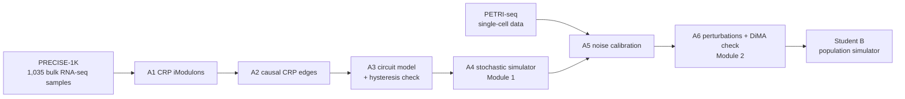
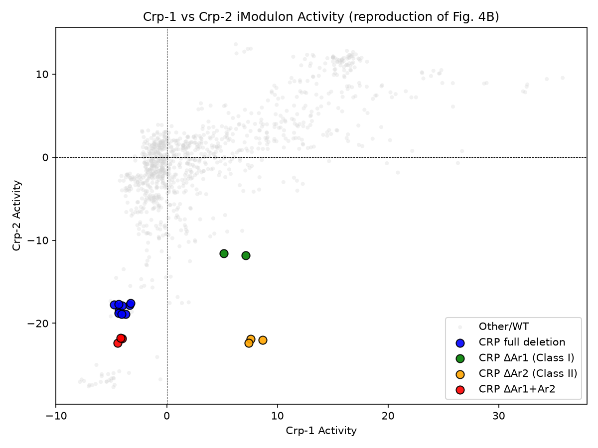
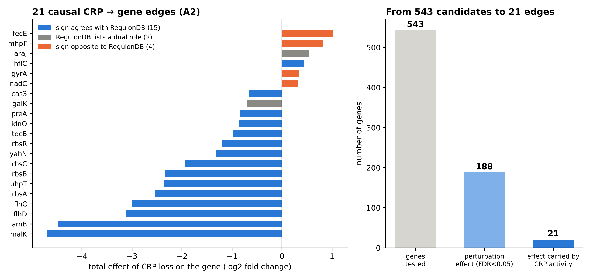
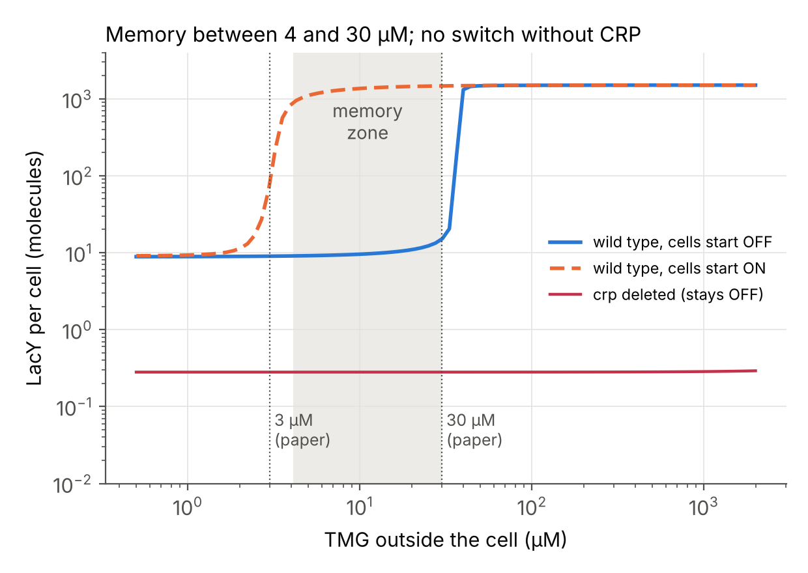
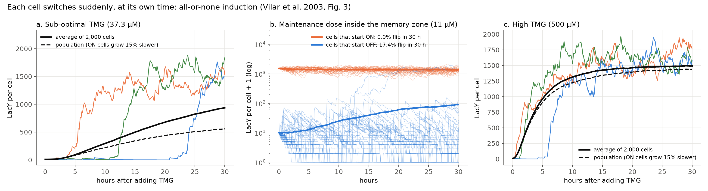
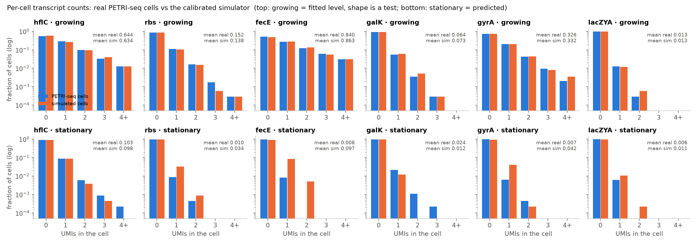
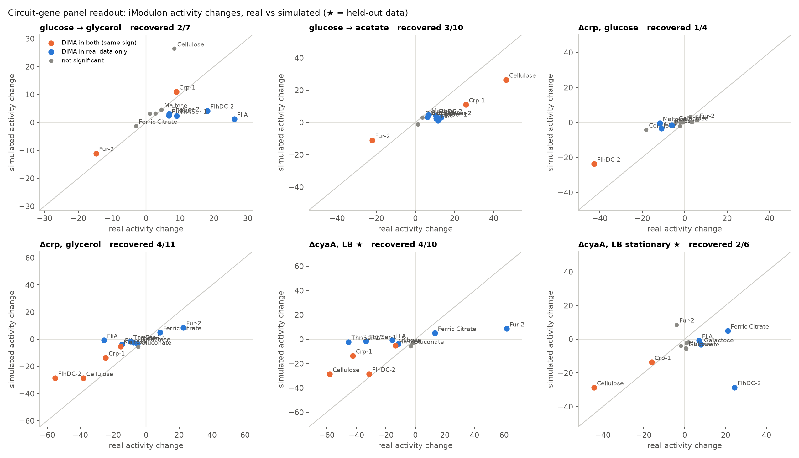

# StochBridge: Track A, data-grounded intracellular engine

A stochastic single-cell model of the *E. coli* CRP / *lac* circuit, built from real data:
bulk RNA-seq (PRECISE-1K) gives the circuit's wiring and parameters, single-cell RNA-seq (PETRI-seq) gives its noise.
The model is wrapped as two modules that Student B's population simulator uses directly:

- **Module 1, `stochastic_engine`**: simulates many single cells and returns their molecule counts over time.
- **Module 2, `perturbation_interface`**: applies a knockout, an inducer change or a carbon-source change to the model.

B.Tech Major Project (BBD451), Department of Biochemical Engineering and Biotechnology, IIT Delhi.
Student A: Anuradha Barnwal (2023BB10659). Supervisor: Prof. Ishaan Gupta.

## How the pieces connect



## Results at a glance

| Task | Paper reproduced | Main result |
|---|---|---|
| A1 | Lamoureux et al. 2023, Fig. 4 | Crp-1 / Crp-2 activity plot reproduced exactly from the PRECISE-1K matrices (R² = 1.00 for all 1,035 samples; gene lists identical) |
| A2 | Turkarslan et al. 2024 (gbmMINER), Fig. 5B–D | 21 of 543 CRP target genes pass the causal-mediation test; 17 agree with RegulonDB. *lac* cannot be tested in this data (taken from RegulonDB and Kuhlman 2007) |
| A3 | Ozbudak et al. 2004, Fig. 1–2 | Fitted *lac* circuit is bistable; predicts the held-out switch-off thresholds within ~23% |
| A4 | Vilar et al. 2003, Fig. 2–3 | Gillespie simulation shows all-or-none (bimodal) induction; a strain without feedback stays unimodal |
| A5 | Blattman et al. 2020 (PETRI-seq) | Noise fitted on ~7,900 cells; matches growing-cell count distributions; the growth-phase split is only partly reproduced |
| A6 | Lamoureux et al. 2023, Fig. 6 | Fig. 6 workflow reproduced exactly (11/11); on our own perturbations 73% of calls are correct (16/22), and this holds on held-out data |

Known gaps: simulated effect sizes are about 3.6× smaller than measured, IPTG induction is too strong in strains carrying extra LacI,
growth-phase biology is not modelled, and A2 has only 3 wild-type samples, so it can miss real CRP edges. Details are in each task's report under `student_a_intracellular/outputs/`.

| A1: CRP iModulons (Fig. 4 reproduced) | A2: 21 causal CRP edges |
|---|---|
|  |  |
| **A3: hysteresis** | **A4: bimodal induction** |
|  |  |
| **A5: simulated vs real counts** | **A6: perturbation DiMA check** |
|  |  |

## Repository layout

```
stochbridge/
├── student_a_intracellular/   Track A (this work): src/, config/, notebooks/, outputs/, tests/
│   └── README.md              per-task entry points, module usage, data set-up
├── shared/schemas/            interface contracts between Student A and Student B
│   ├── trajectory_schema.md   Module 1 output format
│   └── perturbation_schema.md Module 2 API
└── student_b_population/      Track B (Student B), to be added
```

## Quick start

```bash
git clone https://github.com/Ahinueosora/stochbridge
cd stochbridge/student_a_intracellular
pip install -r requirements.txt
# put the PRECISE-1K data files in data/precise1k/ (see student_a_intracellular/README.md, "Data")
pytest -q tests          # 38 tests
```

Using the two modules:

```python
import yaml
from ssa_simulator import StochasticCircuit
from perturbation import GeneKnockout, InducerLevelChange

model = yaml.safe_load(open("outputs/calibrated_circuit_model.yaml"))
traj = StochasticCircuit(GeneKnockout("crp").apply(model)).run(seed=1)   # crp deletion
traj = StochasticCircuit(model).run(InducerLevelChange(30, n_cells=1000, seed=1))  # 30 µM TMG
traj.to_parquet("traj.parquet")
```

Run Python from `student_a_intracellular/src/` (or add it to `PYTHONPATH`).

## Data

Raw data is not stored in git. PRECISE-1K and the public K-12 dataset come from [SBRG/precise1k](https://github.com/SBRG/precise1k)
(archive: doi:10.5281/zenodo.8284223). PETRI-seq counts come from GEO [GSE141018](https://www.ncbi.nlm.nih.gov/geo/query/acc.cgi?acc=GSE141018) (sample GSM4489500).

## Main references

- Lamoureux CR et al. (2023) *Nucleic Acids Res* 51:10176–10193. doi:10.1093/nar/gkad750
- Turkarslan S et al. (2024) *medRxiv*. doi:10.1101/2024.04.05.24305380
- Ozbudak EM et al. (2004) *Nature* 427:737–740. doi:10.1038/nature02298
- Vilar JMG, Guet CC, Leibler S (2003) *J Cell Biol* 161:471–476. doi:10.1083/jcb.200301125
- Blattman SB et al. (2020) *Nat Microbiol* 5:1192–1201. doi:10.1038/s41564-020-0729-6
- Kuhlman T et al. (2007) *PNAS* 104:6043–6048. doi:10.1073/pnas.0606717104

The full reference list is in the final report.
