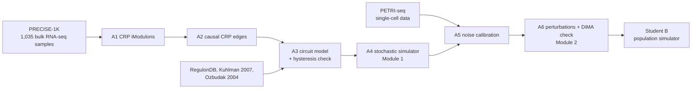
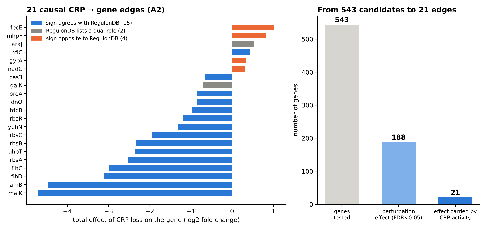
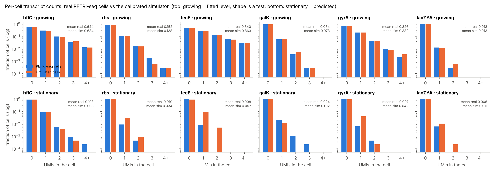
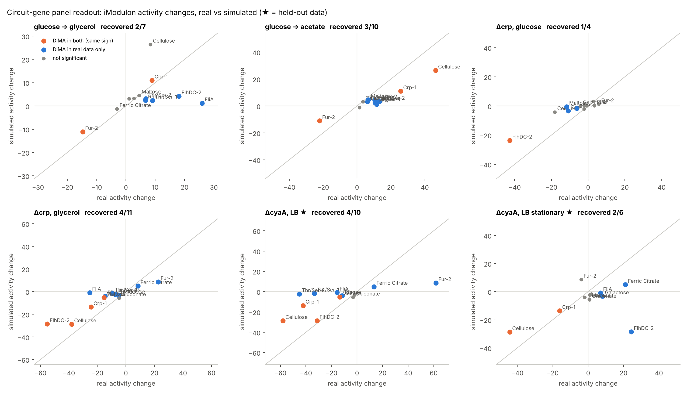

# StochBridge — Track A: data-grounded intracellular engine

A stochastic single-cell model of the *E. coli* **CRP / *lac* circuit**, built step by step from real data and checked at
every step against a published result:

- **Bulk RNA-seq (PRECISE-1K, 1,035 samples)** gives the circuit's wiring (which genes CRP really controls) and its parameters.
- **Single-cell RNA-seq (PETRI-seq, 7,929 cells)** gives its cell-to-cell noise.
- The result is wrapped as two modules that Student B's population simulator uses directly:
  - **Module 1, `stochastic_engine`**: simulates many single cells and returns their molecule counts over time.
  - **Module 2, `perturbation_interface`**: applies a gene knockout, an inducer change or a carbon-source change to the model.

**B.Tech Major Project (BBD451)**, Department of Biochemical Engineering and Biotechnology, IIT Delhi.
**Student A:** Anuradha Barnwal (2023BB10659). **Supervisor:** Prof. Ishaan Gupta.

## Contents
1. [Verify the results (10 minutes)](#1-verify-the-results-10-minutes)
2. [How the six tasks connect](#2-how-the-six-tasks-connect)
3. [Results at a glance](#3-results-at-a-glance)
4. [Each task: question, method, result](#4-each-task-question-method-result)
5. [Using the two modules](#5-using-the-two-modules)
6. [Repository layout](#6-repository-layout)
7. [Data and reproducibility](#7-data-and-reproducibility)
8. [Limitations](#8-limitations)
9. [References](#9-references)

---

## 1. Verify the results (10 minutes)

Needs Python 3.11 or newer (tested with 3.13), git, and a C++ compiler for the simulator
(macOS: `xcode-select --install`; Ubuntu: `sudo apt install g++`).

```bash
git clone https://github.com/Ahinueosora/stochbridge
cd stochbridge/student_a_intracellular
python3 -m venv .venv && source .venv/bin/activate     # Windows: .venv\Scripts\activate
pip install -r requirements.txt                        # the exact package versions that produced the results
python get_data.py                                     # downloads PRECISE-1K (~240 MB; pinned version; checksums checked)
python verify.py                                       # prints PASS / FAIL for every check
```

The last line printed should be **`25 of 25 checks passed.`** (`python verify.py --a3` also refits A3: `28 of 28`).

`verify.py` does four things:

| Step | What is checked |
|---|---|
| Data | The 10 downloaded PRECISE-1K files match the SHA-256 checksums of the version used; the PETRI-seq file is present |
| Rerun | A1 and A2 (and A3 with `--a3`) are recomputed from the raw data in a temporary folder; the results must be identical to the files in `outputs/` |
| Tests | 38 pytest tests: causal-test rule, circuit checks, fixed-seed simulator regression, fast vs exact simulation, noise layer, perturbation API, Lamoureux Fig. 6 reproduction |
| Results | Each task's headline numbers in `outputs/` are compared with the numbers in the report (e.g. 21 causal edges; switch-on at 37.3 µM; Fig. 6 found 11/11; 16 of 22 DiMA calls correct) |

To regenerate **every** output from scratch: `python run_all.py` (about 25 minutes), then `python verify.py`.
This was tested from a fresh clone: with the pinned package versions every number comes out identical.

---

## 2. How the six tasks connect



Each task writes to its own folder, `student_a_intracellular/outputs/a1/` … `a6/`, and the next task reads from it.
Every folder has its own README that explains each figure and file.

---

## 3. Results at a glance

| Task | Paper reproduced | Main result | Verdict | Details |
|---|---|---|---|---|
| **A1** CRP iModulons | Lamoureux et al. 2023, Fig. 4 | Crp-1 / Crp-2 activity plot reproduced exactly (R² = 1.00 for all 1,035 samples; gene lists identical) | Strong | [A1 README](student_a_intracellular/outputs/a1/README.md) |
| **A2** causal edges | Turkarslan et al. 2024 (gbmMINER), Fig. 5B–D | 21 of 543 CRP targets pass the causal-mediation test; 17 agree with RegulonDB; *lac* cannot be tested in this data | Good, small sample | [A2 README](student_a_intracellular/outputs/a2/README.md) |
| **A3** circuit model | Ozbudak et al. 2004, Fig. 1–2 | Bistable *lac* switch; held-out switch-off thresholds predicted within ~23%; cusp at ρ = 9.01 (paper ≈ 9) | Strong | [A3 README](student_a_intracellular/outputs/a3/README.md) |
| **A4** simulator (Module 1) | Vilar et al. 2003, Fig. 2–3 | All-or-none induction; bimodal population from 8 h; a strain without feedback stays unimodal | Strong | [A4 README](student_a_intracellular/outputs/a4/README.md) |
| **A5** noise calibration | Blattman et al. 2020 (PETRI-seq) | Count distributions match growing cells; false switching cut from 19% to 0.9%; growth-phase split reproduced but weaker (AUC 0.65 vs 0.81) | Adequate | [A5 README](student_a_intracellular/outputs/a5/README.md) |
| **A6** perturbations (Module 2) | Lamoureux et al. 2023, Fig. 6 | Fig. 6 workflow reproduced (11/11); on our own perturbations 16 of 22 simulated calls correct (73%), 9 of 11 on held-out data | Adequate | [A6 README](student_a_intracellular/outputs/a6/README.md) |

---

## 4. Each task: question, method, result

### A1 — CRP activity from PRECISE-1K
**Question.** Can the PRECISE-1K data be loaded correctly and Fig. 4 of Lamoureux et al. 2023 rebuilt? Every later task depends on it.
**Method.** Load the gene-weight matrix (M, 4,257 genes × 201 iModulons) and activity matrix (A, 201 × 1,035 samples);
fix one naming mismatch (the same iModulon is "Superoxide" in M and "SoxS" in A); plot Crp-1 vs Crp-2 activity and label the CRP mutant strains.
**Result.** Same pattern as the paper: full *crp* deletions (9 samples) are low on both; ΔAr1 (2) keeps Crp-1 but loses Crp-2; ΔAr2 (3) has the lowest Crp-2.
Activities match the published values for all 1,035 samples.
**Run:** `notebooks/01_crp_reproduction.ipynb`. **Code:** `src/imodulon_loader.py`, `src/condition_response.py`.
**Full details** (inputs, method, every file, checks, limitations): [`outputs/a1/README.md`](student_a_intracellular/outputs/a1/README.md)


### A2 — Which CRP → gene links are causal
**Question.** For which genes does the effect of losing CRP pass *through* CRP activity, rather than just going along with it?
**Method.** The conditioning test of gbmMINER (Fig. 5B–D), applied to 9 *crp* knockouts, 8 CRP domain deletions and 3 wild-type samples:
(1) the gene must change when CRP is lost, in the same direction for knockout and domain deletion (FDR < 0.05);
(2) after adding CRP activity to the model, the knockout effect must vanish (p > 0.05) while CRP activity stays significant (p < 0.05);
(3) CRP activity must carry at least half the effect. CRP activity is the Crp-1 iModulon, recomputed for each gene with that gene left out.
**Result.** 543 genes tested → 188 respond to CRP loss → **21 causal edges** (e.g. maltose *malK*, *lamB*; flagella *flhDC*; ribose *rbsABCR*).
17 of 21 agree with RegulonDB. The *lac* operon cannot be tested: no PRECISE-1K sample has an inducer, so *lac* stays below what RNA-seq can measure.
**Run:** `python src/mediation_test.py`.
**Full details** (inputs, method, every file, checks, limitations): [`outputs/a2/README.md`](student_a_intracellular/outputs/a2/README.md)



### A3 — The CRP / *lac* circuit model
**Question.** Can a data-grounded reaction network reproduce the bistability and hysteresis of real cells (Ozbudak et al. 2004)?
**Method.** Species: promoter states, *lac* mRNA, LacY/LacZ, internal inducer, plus the 21 CRP output genes from A2.
*lac* edges, which A2 could not test, come from RegulonDB (confirmed edges), Kuhlman et al. 2007 (CRP activates *lac* about 200-fold)
and 19 IPTG-induced RNA-seq samples from NCBI SRA (BioProject PRJEB36111), which give the repression factor ρ ≈ 160 and show *lac* tracking CRP (slope 1.07). Hill parameters were fitted to Ozbudak's switch-ON thresholds only;
the switch-OFF thresholds were held out.
**Result.** The model is bistable with a memory window of 4.1–30 µM TMG (paper 3–30 µM); held-out switch-OFF thresholds are predicted
within ~23%; the smallest ρ that gives memory is 9.01 (paper ≈ 9); ρ = 170 and 50 strains switch, ρ = 5 does not; a *crp* knockout never switches ON.
**Run:** `python src/run_a3.py …`, `python src/build_network.py …`, `python src/build_a3_v3.py …` (exact commands in [`student_a_intracellular/README.md`](student_a_intracellular/README.md)).
**Full details** (inputs, method, every file, checks, limitations): [`outputs/a3/README.md`](student_a_intracellular/outputs/a3/README.md)


### A4 — Stochastic single-cell simulator (Module 1)
**Question.** Simulated one cell at a time with random molecular events, do cells switch all-or-none and form two groups (Vilar et al. 2003)?
**Method.** Gillespie SSA in GillesPy2 on the A3 model. A fast mode treats the internal inducer as instantaneous (about 1,000× faster)
and is checked against the exact mode on 400 cells.
**Result.** At 37.3 µM each cell switches suddenly at its own time (10→90% in a median 300 min) while the average rises smoothly (1,256 min);
the population is bimodal from 8 h (dip test p < 0.001); at 11 µM no ON cell switches OFF (memory); a strain without the switch (ρ = 5) stays
unimodal. Stochastic switch-on/off at 37 / 3.4 µM (Ozbudak 30 / 3 µM).
**Run:** `python src/a4_vilar.py`, `python src/a4_validate_modes.py 400`.
**Full details** (inputs, method, every file, checks, limitations): [`outputs/a4/README.md`](student_a_intracellular/outputs/a4/README.md)


### A5 — Noise calibration on real single cells
**Question.** Can the extra cell-to-cell noise of real cells be measured from PETRI-seq and added to the model?
**Method.** 7,929 cells (growing and stationary) from GEO GSE141018; an observation model for sequencing capture; extrinsic noise
fitted by weighted method of moments and checked by approximate Bayesian computation (ABC); the *lac* protein burst size taken from Yu et al. 2006 because *lac* is OFF in PETRI-seq.
**Result.** Extrinsic noise η² = 0.10 ± 0.04 (each gene's rate differs ~30% between cells); simulated count distributions and Fano factors
match growing cells; false *lac* switching drops from 19% to 0.9%. The growing/stationary split appears in simulated cells but weaker
(AUC 0.65 vs 0.81), because about half of the real split is growth biology outside the circuit.
**Run:** `python src/fit_noise_params.py`, `a5_validate.py`, `a5_figures.py`, `a5_sensitivity.py`.
**Full details** (inputs, method, every file, checks, limitations): [`outputs/a5/README.md`](student_a_intracellular/outputs/a5/README.md)



### A6 — Perturbation interface (Module 2) and DiMA validation
**Question.** When a knockout or condition change is simulated, does the model predict the same iModulon changes as the real experiment?
**Method.** `Perturbation.apply(model) → modified model` with subclasses `GeneKnockout`, `InducerLevelChange`, `CarbonSourceShift`;
8 simulated perturbations matched to real PRECISE-1K / K-12 conditions (`config/precise1k_condition_map.yaml`); simulated cells are turned
into pseudo-bulk samples and compared with the real ones by differential iModulon activity (DiMA), as in Lamoureux Fig. 6.
**Result.** The Fig. 6 workflow is reproduced (all 11 paper DiMAs found, largest error 0.016). On the circuit-gene panel, 16 of 22 simulated
calls are correct (73%; 8 of 9 at the paper's stricter thresholds); refitting without the compared samples still gives 9 of 11.
Effects are about 3.6× smaller than measured.
**Run:** `python src/a6_reproduce_aat.py`, `a6_dima_compare.py`, `a6_heldout.py`, `a6_figures.py`.
**Full details** (inputs, method, every file, checks, limitations): [`outputs/a6/README.md`](student_a_intracellular/outputs/a6/README.md)



---

## 5. Using the two modules

```python
# run from student_a_intracellular/src/
import yaml
from ssa_simulator import StochasticCircuit
from perturbation import GeneKnockout, InducerLevelChange, load_perturbations

model = yaml.safe_load(open("../outputs/a5/calibrated_circuit_model.yaml"))

traj = StochasticCircuit(model).run(InducerLevelChange(30, n_cells=1000, seed=1))   # 30 µM TMG, 1,000 cells
traj.to_parquet("traj.parquet")                                                    # cell_id, time, *_count
traj.write_summary("summary_stats.json")                                           # mean, variance, Fano, ON fraction

ko = StochasticCircuit(GeneKnockout("crp").apply(model)).run(seed=1)               # crp deletion

for pert in load_perturbations("../config/precise1k_condition_map.yaml"):          # every matched perturbation
    traj = StochasticCircuit(pert.apply(model)).run(seed=1)
```

File formats: [`shared/schemas/trajectory_schema.md`](shared/schemas/trajectory_schema.md) (Module 1 output) and
[`shared/schemas/perturbation_schema.md`](shared/schemas/perturbation_schema.md) (Module 2 API).

---

## 6. Repository layout

```
stochbridge/
├── README.md                          this file
├── shared/schemas/                    interface contracts between Student A and Student B
│   ├── trajectory_schema.md           Module 1 output format
│   └── perturbation_schema.md         Module 2 API
└── student_a_intracellular/           Track A (this work)
    ├── README.md                      exact command, run time and outputs for every task
    ├── requirements.txt               pinned package versions
    ├── get_data.py                    downloads PRECISE-1K (pinned commit, SHA-256 checked)
    ├── verify.py                      one-command verification (section 1)
    ├── run_all.py                     regenerates every output, A1 -> A6
    ├── data/
    │   ├── precise1k/                 downloaded by get_data.py (not in git)
    │   ├── scrnaseq/GSE141018/        PETRI-seq count matrix from GEO (in git, 3.9 MB)
    │   └── curated/                   RegulonDB evidence and the combined network table (in git)
    ├── src/                           all code (one or more entry scripts per task)
    ├── config/                        circuit spec (A3) and perturbation -> real condition map (A6)
    ├── notebooks/                     01 … 05, one per task, executed
    ├── tests/                         38 pytest tests with fixed seeds
    └── outputs/
        ├── README.md                  index of the six folders
        ├── a1/ … a6/                  each: README.md (explains every figure and file), figures/, results
```

Student B's track (`student_b_population/`) is developed separately.

---

## 7. Data and reproducibility

| Data | Source | How it gets here |
|---|---|---|
| PRECISE-1K and public K-12 RNA-seq | Lamoureux et al. 2023; [SBRG/precise1k](https://github.com/SBRG/precise1k), commit 4829b83 (Zenodo doi:10.5281/zenodo.8284223) | `get_data.py` (10 files, checksums checked) |
| PETRI-seq single cells | Blattman et al. 2020; GEO [GSE141018](https://www.ncbi.nlm.nih.gov/geo/query/acc.cgi?acc=GSE141018), sample GSM4489500 | in the repository |
| RegulonDB evidence for each CRP edge | RegulonDB release 14.5.1, accessed 24 Nov 2026 | in the repository (`data/curated/`) |

- **Pinned versions.** `requirements.txt` lists the exact versions that produced `outputs/`. Newer versions run but can change numbers
  slightly; for example pandas 3.1 changed how missing values become text, so the code now handles missing values explicitly.
- **Fixed seeds.** Every simulation uses a fixed seed, so reruns give identical numbers (figure images differ only in embedded metadata).
- **Cached slow runs.** The exact-mode simulations for the A4 fast-vs-exact check take about 40 minutes and are stored in
  `outputs/a4/exact_*.parquet`; delete them to recompute (the result is identical).

---

## 8. Limitations

- CRP effects on target genes are about 3–4× smaller than measured (A3, A6).
- IPTG over-induces *lac* in strains carrying extra LacI (A6).
- No growth-phase input, so the growing/stationary split is weaker than in real cells (A5).
- Ozbudak's ρ = 5 strain is not matched quantitatively (A3).
- A2 has only 3 wild-type samples, so it can miss real CRP edges.

---

## 9. References

- Lamoureux CR et al. (2023) A multi-scale expression and regulation knowledge base for *Escherichia coli*. *Nucleic Acids Res* 51:10176–10193. doi:10.1093/nar/gkad750
- Turkarslan S et al. (2024) An atlas of causal and mechanistic drivers of interpatient heterogeneity in glioma. *medRxiv*. doi:10.1101/2024.04.05.24305380
- Ozbudak EM et al. (2004) Multistability in the lactose utilization network of *Escherichia coli*. *Nature* 427:737–740. doi:10.1038/nature02298
- Vilar JMG, Guet CC, Leibler S (2003) Modeling network dynamics: the lac operon, a case study. *J Cell Biol* 161:471–476. doi:10.1083/jcb.200301125
- Blattman SB et al. (2020) Prokaryotic single-cell RNA sequencing by in situ combinatorial indexing. *Nat Microbiol* 5:1192–1201. doi:10.1038/s41564-020-0729-6
- Kuhlman T et al. (2007) Combinatorial transcriptional control of the lactose operon of *Escherichia coli*. *PNAS* 104:6043–6048. doi:10.1073/pnas.0606717104
- Yu J et al. (2006) Probing gene expression in live cells, one protein molecule at a time. *Science* 311:1600–1603. doi:10.1126/science.1119623
- Salgado H et al. (2024) RegulonDB v12.0. *Nucleic Acids Res* 52:D255–D264. doi:10.1093/nar/gkad1072

The full reference list (25 entries) is in the final report.
