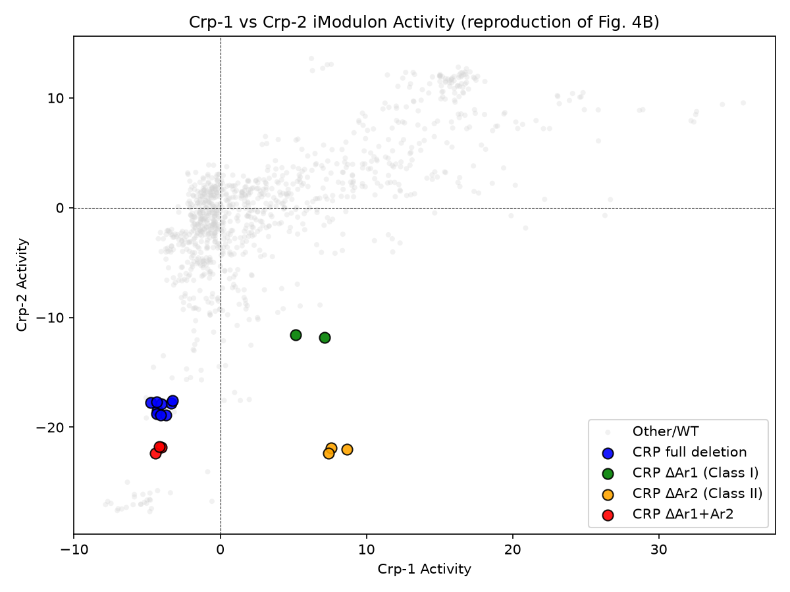

# A1 — CRP activity from PRECISE-1K (iModulons)

[Main README](../../../README.md) · [Commands for every task](../../README.md) · [A1](../a1) · [A2](../a2) · [A3](../a3) · [A4](../a4) · [A5](../a5) · [A6](../a6)

> **Paper reproduced:** Lamoureux et al. 2023, *Nucleic Acids Res* 51:10176, **Fig. 4** (Crp-1 vs Crp-2 iModulon activity)  
> **Verdict:** **Strong** — reproduced exactly  
> **In one line:** The Crp-1 / Crp-2 activity plot is rebuilt from the raw PRECISE-1K matrices and matches the published values for all 1,035 samples (R² = 1.00).

## Contents
1. [Question](#1-question)
2. [Inputs](#2-inputs)
3. [Method](#3-method)
4. [How to run](#4-how-to-run)
5. [Code](#5-code)
6. [Results, figure by figure](#6-results-figure-by-figure)
7. [Checks against the paper](#7-checks-against-the-paper)
8. [Decisions and deviations from the brief](#8-decisions-and-deviations-from-the-brief)
9. [Limitations](#9-limitations)
10. [Every file in this folder](#10-every-file-in-this-folder)
11. [References](#11-references)

## 1. Question
Can the PRECISE-1K data be loaded and handled correctly, so that Fig. 4 of Lamoureux et al. 2023 comes out the same?

This is the onboarding task: every later task reads the CRP activity computed here, so the matrices, gene and sample labels and strain groups must be right.

**Background.** Independent component analysis splits the 1,035 RNA-seq profiles into 201 *iModulons*: groups of genes that rise and fall together. Each iModulon has a weight for every gene (matrix **M**) and an activity in every sample (matrix **A**). CRP's targets fall into two iModulons: **Crp-1** (mostly Class I promoters, CRP binds at −61.5) and **Crp-2** (mostly Class II promoters, CRP binds at −41.5). Deleting CRP's activating region 1 (Ar1) or 2 (Ar2) should hit them differently.

## 2. Inputs
| Input | What it is | Where it comes from |
|---|---|---|
| `M.csv` | gene weights, 4,257 genes × 201 iModulons | SBRG/precise1k (downloaded by `get_data.py`) |
| `A.csv` | iModulon activities, 201 × 1,035 samples | SBRG/precise1k |
| `metadata_qc.csv` | sample annotations: strain, carbon source, project | SBRG/precise1k |
| `TRN.csv` | regulator → gene annotations (RegulonDB/EcoCyc) | SBRG/precise1k |

## 3. Method
1. **Load** M, A, the sample table and the TRN (`src/imodulon_loader.py`). Only the `_qc` files are used, which gives the paper's 4,257 genes × 1,035 samples.
2. **Fix one naming mismatch.** The same iModulon (column 22) is called `Superoxide` in M and `SoxS` in A. The notebook first shows the error this causes, then renames M's column so both matrices list the same 201 iModulons.
3. **Label the CRP mutants** from the strain descriptions: full *crp* deletion (9 samples), ΔAr1 (2), ΔAr2 (3), ΔAr1+Ar2 (3); all other samples are wild type or unrelated.
4. **Plot** Crp-1 against Crp-2 activity for every sample (`src/condition_response.py`) and compare with Fig. 4B.
5. **Save** the activity table with condition metadata for A2 and A3.

## 4. How to run
From `student_a_intracellular/`, after `pip install -r requirements.txt` and `python get_data.py`:

```bash
jupyter nbconvert --to notebook --execute --inplace notebooks/01_crp_reproduction.ipynb
# or: python run_all.py a1
```
Takes about 10 seconds. Writes the three files in this folder.

## 5. Code
| File | What it does |
|---|---|
| [`notebooks/01_crp_reproduction.ipynb`](../../notebooks/01_crp_reproduction.ipynb) | the reproduction, executed, with every step shown |
| [`src/imodulon_loader.py`](../../src/imodulon_loader.py) | loads M, A, metadata and TRN into a small `IcaData` container; fixes the Superoxide/SoxS name |
| [`src/condition_response.py`](../../src/condition_response.py) | extracts a regulon's activity across conditions; builds the activity-by-condition table |

## 6. Results, figure by figure
### 01_crp1_vs_crp2_phase_plane.png: reproduction of Lamoureux Fig. 4B



- **What it shows.** Each dot is one PRECISE-1K sample. x-axis: Crp-1 activity; y-axis: Crp-2 activity. Grey dots are all other samples (1,018); coloured dots are the CRP mutant strains.
- **How to read it.**
  - **Blue, full *crp* deletion (9 samples), and red, both activating regions deleted (3):** low on both axes, so CRP is switched off.
  - **Green, ΔAr1 (Class I region deleted, 2):** keeps positive Crp-1 activity but loses Crp-2.
  - **Orange, ΔAr2 (Class II region deleted, 3):** keeps more Crp-1 activity but has the lowest Crp-2.
- **Outcome.** The same pattern as the paper. Our activities match the published values for all 1,035 samples (R² = 1.00 for both iModulons), and the gene lists match exactly (Crp-1: 61 genes, Crp-2: 21 genes).

---

**One fix needed.** The same iModulon is called "Superoxide" in the gene matrix (M) and "SoxS" in the activity matrix (A). Matching the names made both matrices line up on the same 201 iModulons.

**Note.** The activities come from the published decomposition, not from re-running ICA. This task checks that data, labels and sample groups are handled correctly, which is what the brief asked for.


## 7. Checks against the paper
| Check | Paper / expected | This work | Pass |
|---|---|---|---|
| Crp-1 activity, all samples | published A.csv | R² = 1.00 | ✔ |
| Crp-2 activity, all samples | published A.csv | R² = 1.00 | ✔ |
| Crp-1 / Crp-2 gene lists | 61 / 21 genes | 61 / 21, identical | ✔ |
| Full *crp* deletions | low on both axes | low on both (9 samples) | ✔ |
| ΔAr1 (Class I region) | keeps Crp-1, loses Crp-2 | same (2 samples) | ✔ |
| ΔAr2 (Class II region) | lowest Crp-2 | same (3 samples) | ✔ |
| Recompute from raw data | identical to this folder | max difference 0 | ✔ |

The numbers marked ✔ in `verify.py` are re-checked automatically every time it runs.

## 8. Decisions and deviations from the brief
- **Activities are taken from the published decomposition**, not from re-running ICA. The brief asks to reproduce the figure from the raw matrices to prove data access and handling; re-running ICA would give slightly different components and break the link to every published iModulon name.
- **pymodulon is not used.** The published pymodulon 0.2.1 does not import with current pandas. A1 only needed its container for M, A and the metadata, so `src/imodulon_loader.py` provides the same container and the same check (M and A must name the same iModulons).

## 9. Limitations
- None that affect later tasks. The 1,018 grey samples include many unrelated projects; only the CRP strains are interpreted.

## 10. Every file in this folder
| File | Contents |
|---|---|
| [`crp_activity_by_condition.csv`](crp_activity_by_condition.csv) | Crp-1 and Crp-2 activity for all 1,035 samples, with strain group (`crp_category`), carbon source and project. **Read by A2 and A3.** |
| [`condition_response_curve.csv`](condition_response_curve.csv) | the same table under the file name the brief specifies |
| [`condition_response_curve.png`](condition_response_curve.png) | the Fig. 4B reproduction (same as `figures/01_…`) |
| [`figures/01_crp1_vs_crp2_phase_plane.png`](figures/01_crp1_vs_crp2_phase_plane.png) | figure shown in section 6 |

## 11. References
- Lamoureux CR et al. (2023) *Nucleic Acids Res* 51:10176–10193. doi:10.1093/nar/gkad750
- Sastry AV et al. (2019) The *Escherichia coli* transcriptome mostly consists of independently regulated modules. *Nat Commun* 10:5536. doi:10.1038/s41467-019-13483-w

---
[Main README](../../../README.md) · [Commands for every task](../../README.md) · [A1](../a1) · [A2](../a2) · [A3](../a3) · [A4](../a4) · [A5](../a5) · [A6](../a6)
