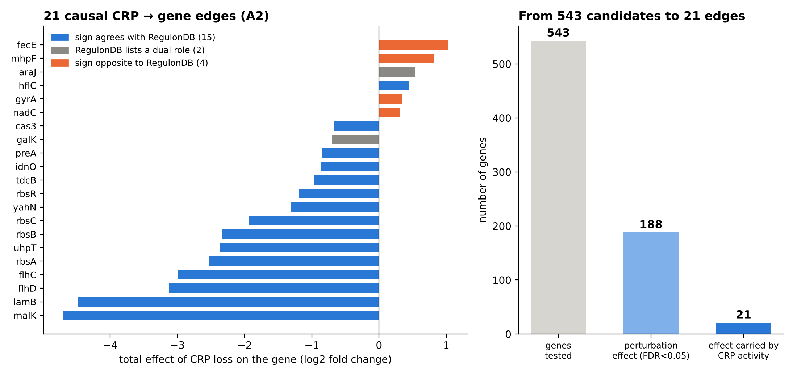

# A2 — Which CRP → gene links are causal (causal-mediation test)

[Main README](../../../README.md) · [Commands for every task](../../README.md) · [A1](../a1) · [A2](../a2) · [A3](../a3) · [A4](../a4) · [A5](../a5) · [A6](../a6)

> **Paper reproduced:** Turkarslan et al. 2024 (gbmMINER), *medRxiv* 2024.04.05.24305380, **Fig. 5B–D** (conditioning on a regulator abolishes a mutation's effect)  
> **Verdict:** **Good, small sample** — 21 causal edges, reproduced exactly on rerun  
> **In one line:** Of 543 CRP target genes, 188 change when CRP is lost and 21 pass the full test that the change runs through CRP activity; 17 of 21 agree with RegulonDB.

## Contents
1. [Question](#1-question)
2. [Inputs](#2-inputs)
3. [Method](#3-method)
4. [How to run](#4-how-to-run)
5. [Code](#5-code)
6. [Results, figure by figure](#6-results-figure-by-figure)
7. [Checks against the paper](#7-checks-against-the-paper)
8. [Decisions and deviations from the brief](#8-decisions-and-deviations-from-the-brief)
9. [Limitations](#9-limitations)
10. [Every file in this folder](#10-every-file-in-this-folder)
11. [References](#11-references)

## 1. Question
CRP is annotated as a regulator of hundreds of genes, but an annotation or a correlation does not show that CRP *causes* a gene's change in these cells. For which genes can the data show that the effect of losing CRP passes **through CRP activity**, rather than just happening alongside it?

gbmMINER (Fig. 5B–D) shows that an IDH1 mutation raises a gene set, and that the rise disappears once the expression of the regulator ETV7 is accounted for, so ETV7 mediates it. A2 applies the same logic with CRP as the regulator and CRP knockouts / domain deletions as the intervention. Only edges that pass are used as the circuit's CRP outputs in A3.

## 2. Inputs
| Input | What it is | Where it comes from |
|---|---|---|
| `precise1k.json.gz`, `log_tpm_qc.csv`, `metadata_qc.csv` | expression of every gene in every sample; M, A and the TRN | SBRG/precise1k (downloaded by `get_data.py`) |
| 9 *crp* knockouts | `del_crp` on fructose, glucose, glycerol | PRECISE-1K project `crp` |
| 8 CRP domain deletions | ΔAr1, ΔAr2, ΔAr1+Ar2, all on glycerol | PRECISE-1K project `crp` |
| 3 wild types | fructose (1), glycerol (2) | PRECISE-1K project `crp` (batch-matched) |
| CRP targets | TRN `Crp` targets + the *lac* operon (543 genes) | TRN from RegulonDB via PRECISE-1K |

## 3. Method
For every target gene Y, with carbon source as a covariate (rule fixed before looking at results):

1. **Total effect.** Fit Y ~ perturbation + carbon. The perturbation must change Y (Benjamini–Hochberg FDR < 0.05).
2. **Sign check.** Fit Y ~ knockout + domain deletion + carbon. Both must move Y in the same direction.
3. **Mediator.** CRP activity C = the Crp-1 iModulon activity, **recomputed for each target with that gene left out** of the projection, so a gene cannot explain itself. With no gene left out this reproduces the published Crp-1 activity (r = 0.9997).
4. **Conditioned model.** Fit Y ~ perturbation + C + carbon. The edge is **causal** when the perturbation term is no longer significant (p > 0.05), C is significant (p < 0.05), and C carries at least 50% of the total effect.
5. **Compare** the 21 edges with RegulonDB (direction and evidence level) and write the edge list.

The rule was checked on simulated data: it misses a true edge about 5% of the time and accepts a false one 0.1% of the time (`tests/test_mediation.py`).

## 4. How to run
From `student_a_intracellular/`, after `pip install -r requirements.txt` and `python get_data.py`:

```bash
python src/mediation_test.py
# or: python run_all.py a2
```
Takes about 1 minute. Writes `mediation_results.csv`, `mediation_summary.json`.

## 5. Code
| File | What it does |
|---|---|
| [`src/mediation_test.py`](../../src/mediation_test.py) | the whole test: sample selection, leave-one-out CRP activity, the three models, the edge list |
| [`tests/test_mediation.py`](../../tests/test_mediation.py) | checks the rule on synthetic data (true and false edges) and that the 21 real edges are reproduced |
| [`notebooks/a2_ecoli_miner_causal_pipeline.ipynb`](../../notebooks/a2_ecoli_miner_causal_pipeline.ipynb) | the earlier exploratory MINER run (needs the separate MINER package; not part of the final pipeline) |

## 6. Results, figure by figure
### 01_21_causal_edges.png



- **Right panel: the filter.** 543 genes tested → 188 respond to CRP loss → **21 pass all three steps**.
- **Left panel: the 21 edges.** Bar length = how much the gene changes when CRP is lost (log2 fold change). Most go down, as expected, because CRP mostly activates. The biggest: maltose genes *malK* and *lamB* (about −4.7 and −4.5), the flagella master switch *flhDC*, and the ribose genes *rbsABCR*.
- **Colours: comparison with RegulonDB** (the curated database of known E. coli regulation):
  - **Blue (15):** same direction as RegulonDB.
  - **Grey (2):** RegulonDB lists a dual role, so consistent.
  - **Orange (4):** opposite direction (*fecE*, *mhpF*, *nadC*, *gyrA*). These depend on CRP but probably indirectly. For example, CRP activates Fur, which represses *fecE*.
- **Outcome.** 17 of 21 edges agree with known biology; 5 of them carry RegulonDB's highest evidence level ("confirmed").

---

**One change from the brief.** The brief says to condition on CRP's own mRNA level. In the knockouts, CRP mRNA and the knockout label are almost the same thing (r = −0.998), and domain-deletion strains make normal CRP mRNA but lose its function. So with mRNA no edge can pass. We used **CRP activity** (the Crp-1 iModulon, recomputed for each gene with that gene left out so it cannot explain itself) instead.

**The *lac* operon could not be tested.** No PRECISE-1K sample contains an inducer, so *lac* is kept almost fully off and its CRP effect is below what RNA-seq can measure. The CRP → *lac* and LacI ⊣ *lac* edges were therefore taken from RegulonDB and Kuhlman et al. 2007 (see A3).

**Limitations.** Only 3 wild-type samples, and domain deletions only on glycerol, so power is low: a gene that fails is not proof that CRP does not act on it. On simulated data the rule misses a true edge about 5% of the time and accepts a false one 0.1% of the time.


## 7. Checks against the paper
| Check | Paper / expected | This work | Pass |
|---|---|---|---|
| Genes tested | CRP targets + lac | 543 | ✔ |
| Respond to CRP loss (FDR < 0.05, same sign) | – | 188 | ✔ |
| Causal (mediated by CRP activity) | – | 21 | ✔ |
| Leave-none-out CRP activity vs published Crp-1 | r ≈ 1 | r = 0.9997 | ✔ |
| Agree with RegulonDB direction | – | 17 of 21 (15 same, 2 dual) | – |
| Edges with CRP mRNA as mediator | (see section 8) | 0 | – |
| Rerun from raw data | identical | identical | ✔ |

The numbers marked ✔ in `verify.py` are re-checked automatically every time it runs.

## 8. Decisions and deviations from the brief
- **CRP activity instead of CRP mRNA as the mediator.** The brief says to condition on CRP's own expression. In the knockouts, CRP mRNA and the knockout label are almost the same variable (r = −0.996), so conditioning erases every effect by collinearity alone; and the domain-deletion strains make normal CRP mRNA but lose CRP *function*. With mRNA as the mediator 0 edges pass (also reported). CRP activity is the quantity that carries the effect.
- **Leave-one-out activity** avoids circularity: only 3 of the 21 causal genes are Crp-1 members at all.
- **The *lac* operon could not be tested.** No PRECISE-1K sample contains a *lac* inducer, so *lac* is held almost fully OFF and the CRP effect on it is below RNA-seq's detection floor (shown in A3). The *lac* edges are therefore taken from RegulonDB and Kuhlman et al. 2007 in A3.
- This is a causal-mediation (conditioning) test, **not Mendelian randomization**, as the brief requires.

## 9. Limitations
- Only 3 wild-type samples, and domain deletions only on glycerol, so statistical power is low: a gene that fails is not evidence that CRP does not regulate it.
- 4 of the 21 edges go in the opposite direction to RegulonDB (*fecE*, *mhpF*, *nadC*, *gyrA*). They depend on CRP but probably indirectly (for example CRP → Fur ⊣ *fecE*).

## 10. Every file in this folder
| File | Contents |
|---|---|
| [`mediation_results.csv`](mediation_results.csv) | **main result**: every tested gene with total effect, knockout and domain-deletion effects, FDR, conditioned p-values, % mediated, causal yes/no, RegulonDB comparison |
| [`mediation_summary.json`](mediation_summary.json) | counts at each step (543 → 188 → 21), the mRNA-mediator result, the Crp-1 reproduction r |
| [`a2_mediation_report.md`](a2_mediation_report.md) | full write-up, including the table of all 21 edges |
| [`fig_a2_edges.png`](fig_a2_edges.png) | the 21 edges and the filter (same as `figures/01_…`) |
| [`../a3/validated_edges.json`](../a3/validated_edges.json) | the circuit's final edge list (built in A3 from these 21 edges plus the *lac* evidence) |
| `filteredCausalResults.csv`, `ecoli_crp_ko_only/`, `ecoli_crp_matched/`, `fig10_…`, `fig11_…`, `fig12_…`, `validated_edges_external.json` | *earlier exploratory MINER analysis* (notebook `a2_ecoli_miner_causal_pipeline.ipynb`); kept for the record, not used downstream |

## 11. References
- Turkarslan S et al. (2024) An atlas of causal and mechanistic drivers of interpatient heterogeneity in glioma. *medRxiv*. doi:10.1101/2024.04.05.24305380
- Plaisier CL et al. (2016) Causal mechanistic regulatory network for glioblastoma. *Cell Syst* 3:172–186. doi:10.1016/j.cels.2016.06.006
- Lamoureux CR et al. (2023) *Nucleic Acids Res* 51:10176–10193. doi:10.1093/nar/gkad750
- Salgado H et al. (2024) RegulonDB v12.0. *Nucleic Acids Res* 52:D255–D264. doi:10.1093/nar/gkad1072

---
[Main README](../../../README.md) · [Commands for every task](../../README.md) · [A1](../a1) · [A2](../a2) · [A3](../a3) · [A4](../a4) · [A5](../a5) · [A6](../a6)
