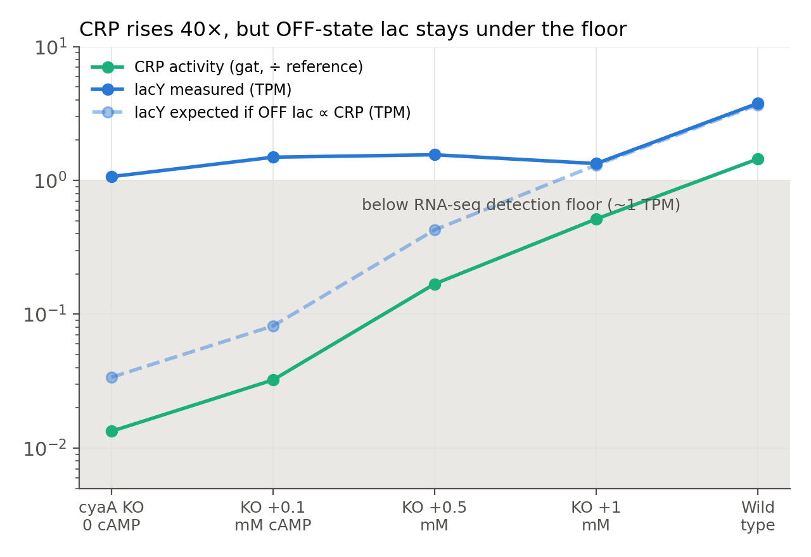
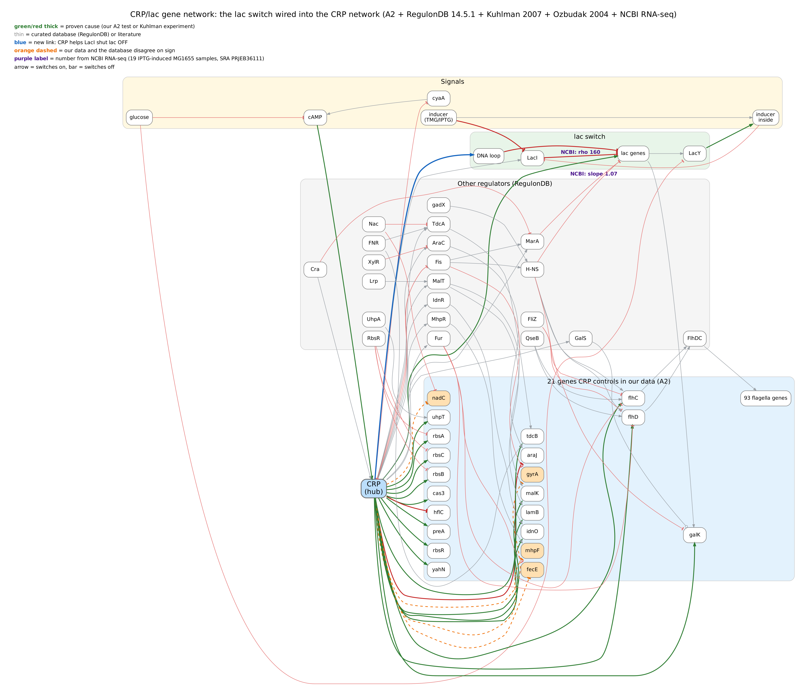
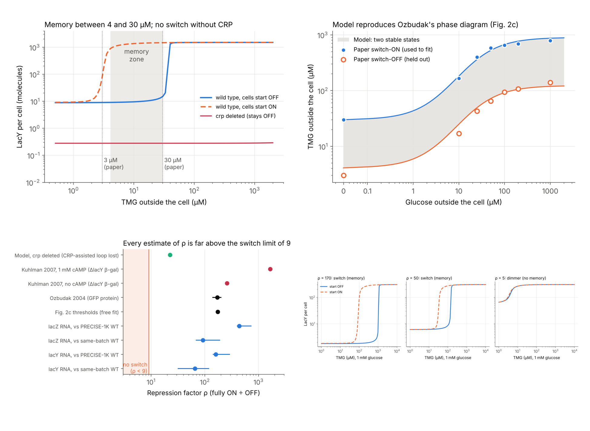
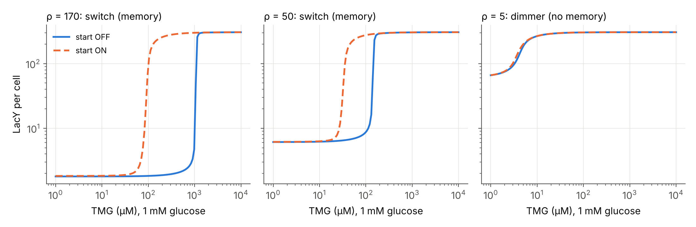
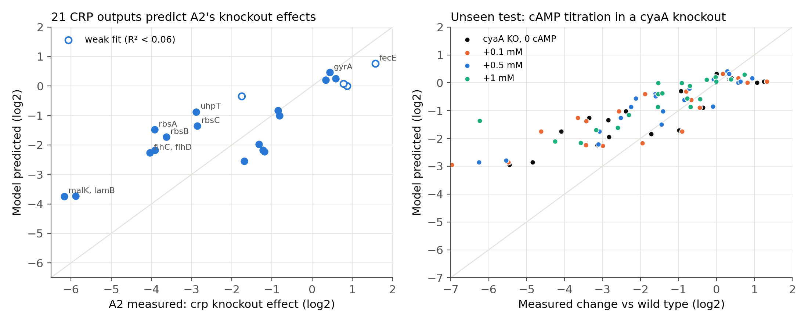

# A3 — The CRP / *lac* circuit model: topology, rate constants, hysteresis

[Main README](../../../README.md) · [Commands for every task](../../README.md) · [A1](../a1) · [A2](../a2) · [A3](../a3) · [A4](../a4) · [A5](../a5) · [A6](../a6)

> **Paper reproduced:** Ozbudak et al. 2004, *Nature* 427:737, **Fig. 1–2** (bistability and hysteresis of the *lac* network)  
> **Verdict:** **Strong** — passes every structural check, including held-out data  
> **In one line:** A bistable *lac* switch fitted only to Ozbudak's switch-ON thresholds predicts his held-out switch-OFF thresholds within ~23%, with a cusp at ρ = 9.01 (paper ≈ 9).

## Contents
1. [Question](#1-question)
2. [Inputs](#2-inputs)
3. [Method](#3-method)
4. [How to run](#4-how-to-run)
5. [Code](#5-code)
6. [Results, figure by figure](#6-results-figure-by-figure)
7. [Checks against the paper](#7-checks-against-the-paper)
8. [Decisions and deviations from the brief](#8-decisions-and-deviations-from-the-brief)
9. [Limitations](#9-limitations)
10. [Every file in this folder](#10-every-file-in-this-folder)
11. [References](#11-references)

## 1. Question
Can we build a reaction network of the *lac* switch, grounded in data, that behaves like real cells before it is made stochastic? The test is Ozbudak et al. 2004: *E. coli* induced by TMG show **hysteresis** — cells that start OFF switch ON near 30 µM, cells that start ON stay ON down to about 3 µM, and in between the cell remembers its history.

The model also carries the 21 causal CRP outputs from A2, so later tasks can compare whole-cell expression.

## 2. Inputs
| Input | What it is | Where it comes from |
|---|---|---|
| `../a1/crp_activity_by_condition.csv` | CRP activity per sample | A1 |
| `../a2/mediation_results.csv` | the 21 causal CRP → gene edges | A2 |
| PRECISE-1K + K-12 modulome expression | for ρ from RNA and for the CRP-output fits | SBRG/precise1k (`get_data.py`) |
| `data/curated/regulondb_crp_edges.json` | RegulonDB evidence for each CRP edge | RegulonDB 14.5.1 (curated, in git) |
| `data/curated/lac_network_gene_check.xlsx` | combined network table: RegulonDB + A2 + Kuhlman + Ozbudak | curated, in git |
| Ozbudak 2004 Fig. 2c thresholds | switch-ON / switch-OFF TMG at each glucose level | digitised in `src/fit_parameters.py` |
| Kuhlman 2007 | CRP raises *lac* ~200-fold; CRP-free basal 1/240; LacI loop | published values in the code |
| 19 IPTG-induced + 3 uninduced MG1655 RNA-seq samples | *lac* fully ON: repression strength ρ and the CRP → *lac* slope | NCBI SRA BioProject PRJEB36111 (project `srna_oe` in the K-12 modulome; `get_data.py`) |

## 3. Method
1. **Topology.** Species: *lac* promoter (free / LacI-bound), *lac* mRNA, LacY (the permease), internal inducer, plus mRNA and protein for each of the 21 CRP outputs. Reactions: transcription (CRP-activated, LacI-repressed), translation, decay/dilution, LacY-dependent inducer uptake, inducer release of LacI, glucose → lower cAMP and inducer exclusion (`src/reaction_network.py`).
2. **Where the *lac* edges come from.** A2 could not test *lac* (no inducer in PRECISE-1K). Each edge is instead backed by RegulonDB 'Confirmed' evidence, the Kuhlman 2007 cAMP titration (with a Δcrp control), 19 IPTG-induced RNA-seq samples from NCBI SRA (BioProject PRJEB36111), and Ozbudak's own measurements. Every edge's source is recorded in `validated_edges.json`.
3. **Repression factor ρ** (how much LacI shuts *lac* off) from three routes: Ozbudak's GFP (170), a free fit to his phase diagram (173), and RNA-seq *lacY* in 19 IPTG-induced MG1655 samples from NCBI SRA (BioProject PRJEB36111) vs uninduced PRECISE-1K MG1655 (160, the only route independent of Ozbudak).
4. **Fit.** Hill parameters are fitted to Ozbudak's **switch-ON** thresholds only; the **switch-OFF** thresholds are held out and predicted (`src/fit_parameters.py`).
5. **CRP outputs.** Each of the 21 A2 genes gets a Hill response to CRP activity fitted on PRECISE-1K (`src/crp_outputs.py`), validated on an unseen cAMP-titration experiment.
6. **Build the final model** (v3): network table → circuit edges with evidence → parameters, initial states for OFF and ON history, a crp-knockout version (CRP-free basal 1/240, LacI loop ρ 170 → 22 as in Kuhlman) → `circuit_model.yaml` and SBML (`src/build_network.py`, `src/build_a3_v3.py`).
7. **Checks.** Steady states, hysteresis loop, phase diagram, cusp, titration strains, Δcrp; the SBML is loaded and run in libSBML, GillesPy2 and COPASI.

## 4. How to run
From `student_a_intracellular/`, after `pip install -r requirements.txt` and `python get_data.py`:

```bash
python src/run_a3.py data/precise1k/precise1k/data outputs/a3
(cd outputs/a3 && python ../../src/build_network.py ../../data/curated/lac_network_gene_check.xlsx)
python src/build_a3_v3.py outputs/a3/network_v3_edges.csv outputs/a3
jupyter nbconvert --to notebook --execute --inplace notebooks/02_hysteresis_check.ipynb
# or: python run_all.py a3
```
Takes about 3 minutes. `python verify.py --a3` refits A3 and checks the result is identical.

## 5. Code
| File | What it does |
|---|---|
| [`src/reaction_network.py`](../../src/reaction_network.py) | species, reactions and propensities; deterministic steady states |
| [`src/fit_parameters.py`](../../src/fit_parameters.py) | fits Hill parameters to Ozbudak's switch-ON thresholds; ρ from PRECISE-1K RNA |
| [`src/crp_outputs.py`](../../src/crp_outputs.py) | Hill fits for the 21 A2 genes; cAMP-titration validation |
| [`src/run_a3.py`](../../src/run_a3.py) | driver: fit → hysteresis check → figures → report numbers |
| [`src/build_network.py`](../../src/build_network.py) | combines RegulonDB, A2, Kuhlman and Ozbudak into one edge table with evidence |
| [`src/build_a3_v3.py`](../../src/build_a3_v3.py) | builds the final model, the crp-knockout version, the SBML; runs the COPASI/GillesPy2 checks |
| [`config/crp_lac_circuit.yaml`](../../config/crp_lac_circuit.yaml) | human-readable species / reactions / parameter spec |
| [`notebooks/02_hysteresis_check.ipynb`](../../notebooks/02_hysteresis_check.ipynb) | the hysteresis and phase-diagram reproduction, executed |
| [`tests/test_circuit.py`](../../tests/test_circuit.py) | 11 tests: steady states, hysteresis, cusp, Δcrp stays OFF, SBML imports |

## 6. Results, figure by figure
### 01_lac_below_detection_floor.png: why A2 could not test lac



- **What it shows.** A cyaA knockout given 0 to 1 mM cAMP. CRP activity (green) rises about 40-fold. Measured lacY (dark blue) stays flat at about 1–1.6 TPM. The dashed line is what lacY *would* be if it followed CRP.
- **How to read it.** The grey zone is below what RNA-seq can measure (about 1 TPM). The expected lacY sits inside it, so the change is invisible.
- **Outcome.** A2's "no lac edge" is a measurement limit, not evidence against the edge.

### 02_crp_lac_gene_network.png: the lac switch wired into the whole CRP gene network



- **What it shows.** One gene network built from five sources: the signals (glucose, cAMP, inducer) at the top, the *lac* switch (green box), CRP as the hub, the 21 genes CRP controls in our A2 data (blue box), and the other regulators of those genes from RegulonDB (grey box).
- **How to read it.** Arrow = switches on, bar = switches off. Thick green/red = a proven cause (our A2 test or the Kuhlman 2007 experiment). Thin = curated database or literature. Blue = the new link where CRP helps LacI shut *lac* off (DNA loop). Orange dashed = our data and RegulonDB disagree on the sign (fecE, mhpF, nadC, gyrA). Purple labels = numbers from NCBI RNA-seq.
- **Where the *lac* edges come from:**
  - **RegulonDB 14.5.1:** CRP → lac and LacI ⊣ lac are "Confirmed".
  - **Kuhlman 2007:** cAMP titration with LacI removed; lac rises about 200× and stays flat in Δcrp.
  - **NCBI RNA-seq (19 IPTG-induced RNA-seq samples from NCBI SRA (BioProject PRJEB36111)):** repression factor ρ ≈ 160 (LacI ⊣ lac), and *lacY* tracks CRP activity with slope 1.07, r = 0.93 (CRP → lac).
  - **Ozbudak 2004:** uptake and glucose effects.
- **Outcome.** Every *lac* edge is supported by curated or interventional evidence, and the *lac* switch sits inside the same CRP network that A2 tested. The figure draws 85 causal and curated edges (53 nodes); the full table has 116 edges, including 31 statistical MINER links left out of the picture. Each edge's source is recorded in [`network_v3_edges.json`](network_v3_edges.json) and [`validated_edges.json`](validated_edges.json). Drawn by `src/draw_network.py` from `network_v3_edges.csv`.

### 03_hysteresis_phase_diagram_rho.png: the main test against Ozbudak



- **Top left (hysteresis).** Cells that start OFF switch ON near 30 µM TMG. Cells that start ON stay ON down to about 4 µM. Between the two, the cell remembers its history. A crp knockout never switches ON.
- **Top right (phase diagram vs Ozbudak Fig. 2c).** The model was fitted only to the switch-ON points. The switch-OFF points were held out and predicted.
- **Bottom left.** Three independent estimates of the repression factor ρ: 170 from GFP, 173 from a free fit, 160 from RNA-seq. All are far above 9, the minimum needed for a switch.
- **Bottom right.** Strains with ρ = 170 and 50 switch; ρ = 5 does not.

| Check | Paper | Model | Pass |
|---|---|---|---|
| Switch-ON error (fitted), log₁₀ | – | 0.037 | – |
| **Switch-OFF error (held out), log₁₀** | – | **0.090 (~23%)** | yes |
| Memory window, no glucose | 3–30 µM | 4.1–30 µM | yes |
| Memory window, 1 mM glucose | ~140–790 µM | 119–871 µM | yes |
| ON/OFF ratio | >100 | 170 | yes |
| Cusp (smallest ρ with memory) | ≈ 9 | 9.01 | yes |
| Δcrp strain | no induction | <1 LacY up to 2 mM TMG | yes |

### 04_switch_vs_dimmer_strains.png: switch vs dimmer



- **What it shows.** The same model at three repression strengths (1 mM glucose).
  - **ρ = 170 and ρ = 50:** two curves (start OFF vs start ON), so the cell has memory.
  - **ρ = 5:** one curve, a smooth dimmer with no memory.
- **Outcome.** Same qualitative behaviour as Ozbudak's strains.
- **Gaps.**
  - The ρ = 5 response is less steep than Ozbudak's fitted curve: Hill 2.7 vs ≈ 6, although his 5 points allow 2.7–6.0.
  - The ρ = 5 strain switches on at ~5 µM, against ~160 µM in his data.

### 05_crp_target_genes.png: the 21 A2 genes as outputs of CRP



- **Left.** Predicted vs measured knockout effects, r = 0.85.
- **Right.** An unseen cAMP titration experiment, not used in fitting: r = 0.79, direction correct 93% of the time.
- **Outcome.** The direction is right, but predicted effects are about half the measured size. Each gene also has other regulators.


## 7. Checks against the paper
| Check | Paper / expected | This work | Pass |
|---|---|---|---|
| Switch-ON thresholds (fitted) | Ozbudak Fig. 2c | log10 error 0.037 (~9%) | – |
| **Switch-OFF thresholds (held out)** | Ozbudak Fig. 2c | log10 error 0.090 (~23%) | ✔ |
| Memory window, no glucose | 3–30 µM | 4.1–30 µM | – |
| Memory window, 1 mM glucose | ~140–790 µM | 119–871 µM | – |
| ON/OFF ratio | > 100 | 170 | – |
| Cusp (smallest ρ with memory) | ≈ 9 | 9.01 | ✔ |
| ρ = 170 and 50 switch, ρ = 5 graded | yes | yes | ✔ |
| Δcrp never induces | flat (Kuhlman) | LacY < 1 per cell up to 2 mM TMG | ✔ |
| ρ from NCBI RNA-seq (independent of Ozbudak) | > 9 for a switch | 160 (model 170) | – |
| CRP → *lac* in NCBI RNA-seq | lac ∝ CRP (Ozbudak Fig. 3b) | slope 1.07, r = 0.93 | – |
| CRP outputs vs A2 knockout effects | – | r = 0.85 | – |
| CRP outputs vs unseen cAMP titration | – | r = 0.79, direction right 93% | – |
| SBML in libSBML / COPASI / GillesPy2 | loads and runs | 0 errors; COPASI = Python ODE | – |

The numbers marked ✔ in `verify.py` are re-checked automatically every time it runs.

## 8. Decisions and deviations from the brief
- **The brief asks for a network built only from A2-validated edges.** A2 could not test *lac* (below detection without inducer, see figure 01), so *lac* edges carry curated and interventional evidence instead, recorded edge by edge (`validated_by` in `validated_edges.json`).
- **Held-out test.** Only switch-ON thresholds are fitted; switch-OFF is predicted, so the phase-diagram match is a real test.
- **Glucose does not lower ρ** in the model: allowing it breaks the phase-diagram fit.

## 9. Limitations
- The ρ = 5 strain is less steep than Ozbudak's fit (Hill 2.7 vs ≈ 6, although his 5 points allow 2.7–6.0) and switches on at ~5 µM instead of ~160 µM.
- CRP-output effects are about half the measured size: each gene also has other regulators that the circuit does not contain.

## 10. Every file in this folder
| File | Contents |
|---|---|
| [`circuit_model.yaml`](circuit_model.yaml) | **the final model**: species, reactions with propensities, parameters with sources, OFF/ON initial states, 31 circuit edges with evidence, 85 context edges, 21 CRP outputs. **Read by A4.** |
| [`circuit_model.xml`](circuit_model.xml) | the same model in SBML L3V2 (TMG 15 µM, no glucose, cells starting OFF) |
| [`validated_edges.json`](validated_edges.json) | every circuit edge and the evidence for it (A2, RegulonDB grade, Kuhlman, Ozbudak) |
| [`network_v3_edges.csv`](network_v3_edges.csv), [`network_v3_edges.json`](network_v3_edges.json) | the combined edge table built from the curated network file |
| [`fitted_params.json`](fitted_params.json) | fitted Hill parameters and ρ |
| [`threshold_fit_vs_ozbudak.csv`](threshold_fit_vs_ozbudak.csv) | model vs Ozbudak switch-ON/OFF thresholds at every glucose level |
| [`rho_estimates_rnaseq.csv`](rho_estimates_rnaseq.csv) | ρ estimated from PRECISE-1K *lacY* RNA |
| [`crp_outputs_fit.csv`](crp_outputs_fit.csv), [`crp_outputs_summary.json`](crp_outputs_summary.json) | Hill fits for the 21 CRP outputs and their summary |
| [`crp_outputs_validation_raman.csv`](crp_outputs_validation_raman.csv) | CRP-output predictions vs the unseen cAMP-titration experiment |
| [`a3_checks_v3.json`](a3_checks_v3.json) | every check number in section 7 |
| [`parameter_fit_report.md`](parameter_fit_report.md) | full write-up |
| [`hysteresis_check.png`](hysteresis_check.png), `fig_a3_*.png` | figures written by the code (the curated versions are in `figures/`) |
| `a3_checks.json`, `circuit_model_TMG15_G0.xml` | *intermediate first-version (v2) outputs* written by `run_a3.py`; superseded by the v3 files above |

## 11. References
- Ozbudak EM et al. (2004) Multistability in the lactose utilization network of *E. coli*. *Nature* 427:737–740. doi:10.1038/nature02298
- Kuhlman T et al. (2007) Combinatorial transcriptional control of the lactose operon of *E. coli*. *PNAS* 104:6043–6048. doi:10.1073/pnas.0606717104
- Salgado H et al. (2024) RegulonDB v12.0. *Nucleic Acids Res* 52:D255–D264. doi:10.1093/nar/gkad1072
- Hoops S et al. (2006) COPASI. *Bioinformatics* 22:3067–3074. doi:10.1093/bioinformatics/btl485

---
[Main README](../../../README.md) · [Commands for every task](../../README.md) · [A1](../a1) · [A2](../a2) · [A3](../a3) · [A4](../a4) · [A5](../a5) · [A6](../a6)
