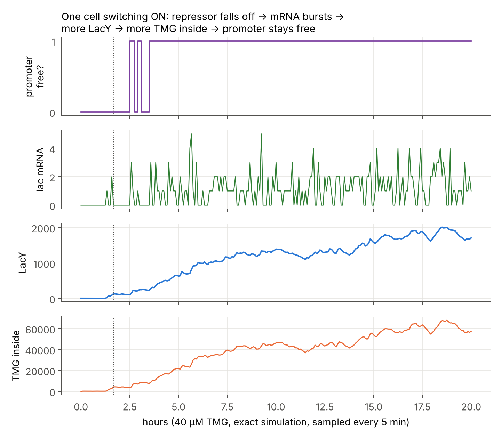
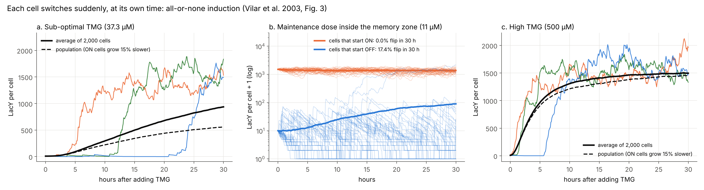
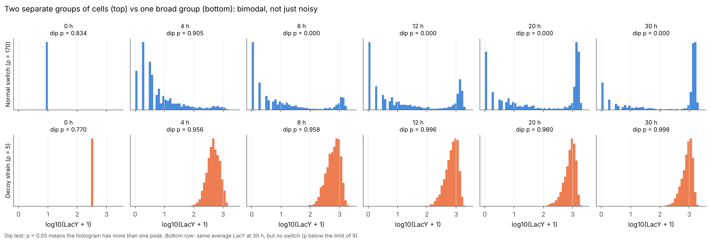

# A4 — Stochastic single-cell simulator (Module 1)

[Main README](../../../README.md) · [Commands for every task](../../README.md) · [A1](../a1) · [A2](../a2) · [A3](../a3) · [A4](../a4) · [A5](../a5) · [A6](../a6)

> **Paper reproduced:** Vilar, Guet & Leibler 2003, *J Cell Biol* 161:471, **Fig. 2–3** (stochastic all-or-none *lac* induction)  
> **Verdict:** **Strong** — all-or-none, bimodal induction and memory reproduced  
> **In one line:** Simulated one molecule at a time, each cell switches ON suddenly at its own random time, the population splits into two groups, and a strain without the switch stays one group.

## Contents
1. [Question](#1-question)
2. [Inputs](#2-inputs)
3. [Method](#3-method)
4. [How to run](#4-how-to-run)
5. [Code](#5-code)
6. [Results, figure by figure](#6-results-figure-by-figure)
7. [Checks against the paper](#7-checks-against-the-paper)
8. [Decisions and deviations from the brief](#8-decisions-and-deviations-from-the-brief)
9. [Limitations](#9-limitations)
10. [Every file in this folder](#10-every-file-in-this-folder)
11. [References](#11-references)

## 1. Question
When the A3 model is simulated **one cell at a time with random molecular events** (Gillespie's stochastic simulation algorithm, SSA), do cells switch all-or-none and form two separate groups, as Vilar et al. 2003 showed? Or is the result just a noisy version of the average?

This simulator is **Module 1**, the engine Student B's population model calls for every cell.

## 2. Inputs
| Input | What it is | Where it comes from |
|---|---|---|
| `../a3/circuit_model.yaml` | the parameterised circuit | A3 |
| `Perturbation` objects | inducer level, carbon source, knockout, operator decoy | `src/perturbation.py` (A6 extends it) |

## 3. Method
1. **Engine** (`src/ssa_simulator.py`). `StochasticCircuit(model)` compiles the circuit once into GillesPy2's C++ SSA solver; `run(perturbation)` simulates N cells with a fixed seed and returns a `Trajectory` (molecule counts per cell over time, format in `shared/schemas/trajectory_schema.md`).
2. **Two modes.** *Exact*: all reactions, internal inducer molecule by molecule. *Fast* (default): internal inducer held at its quasi-steady level (it relaxes in ~2 min while LacY changes over hours), about 1,000× faster. The two are compared on 400 cells.
3. **Vilar Fig. 3** with our circuit, doses scaled to our memory window (4.1–30 µM): (a) sub-optimal dose 37.3 µM, 2,000 cells; (b) maintenance dose 11 µM from both histories, 1,000 cells each; (c) high dose 500 µM; plus one exact cell at 40 µM to show the molecular mechanism.
4. **Bimodal or just noisy?** Hartigan's dip test on the LacY distribution over time, compared with an `OperatorDecoy(ρ = 5)` strain at a dose giving the same average.
5. **Stochastic hysteresis.** 1,000 cells per dose from each history, 20 h, compared with the ODE and Ozbudak.

## 4. How to run
From `student_a_intracellular/`, after `pip install -r requirements.txt` and `python get_data.py`:

```bash
python src/a4_vilar.py
python src/a4_validate_modes.py 400
jupyter nbconvert --to notebook --execute --inplace notebooks/03_vilar_reproduction.ipynb
# or: python run_all.py a4
```
`a4_vilar.py` takes about 14 minutes. The exact-mode runs for the fast-vs-exact check take about 40 minutes, so they are stored in `exact_*.parquet` and reused; delete those three files to recompute them (the result is identical). All runs use fixed seeds.

## 5. Code
| File | What it does |
|---|---|
| [`src/ssa_simulator.py`](../../src/ssa_simulator.py) | **Module 1**: `StochasticCircuit`, exact and fast modes, `run(perturbation) -> Trajectory` |
| [`src/io_schema.py`](../../src/io_schema.py) | the `Trajectory` format: columns, metadata, validation, parquet I/O, summary statistics (mean, variance, Fano, ON fraction, bimodality) |
| [`src/perturbation.py`](../../src/perturbation.py) | perturbations applied to the model (shared with A6) |
| [`src/a4_vilar.py`](../../src/a4_vilar.py) | all Vilar, bimodality and hysteresis runs |
| [`src/a4_validate_modes.py`](../../src/a4_validate_modes.py) | fast vs exact comparison |
| [`notebooks/03_vilar_reproduction.ipynb`](../../notebooks/03_vilar_reproduction.ipynb) | the reproduction, executed |
| [`tests/test_ssa_reproducibility.py`](../../tests/test_ssa_reproducibility.py) | 12 tests: fixed seeds give identical results, golden regression, schema, memory, bimodal vs unimodal, Δcrp stays OFF |
| [`shared/schemas/trajectory_schema.md`](../../../shared/schemas/trajectory_schema.md) | the output contract for Student B |

## 6. Results, figure by figure
### 01_one_cell_switching_on.png: what happens inside one cell



- **What it shows.** One simulated cell at 40 µM TMG over 20 hours (exact simulation). Panels from top:
  1. Is the promoter free of LacI?
  2. lac mRNA.
  3. LacY permease.
  4. TMG inside the cell.
- **How to read it.** Around 2.5 h the repressor falls off a few times. mRNA bursts make LacY. LacY pulls in more TMG, and the TMG keeps the promoter free for good.
- **Outcome.** The positive-feedback mechanism works at the molecular level.

### 02_vilar_reproduction.png: reproduction of Vilar Fig. 3



- **(a) Sub-optimal dose, 37.3 µM.**
  - Each thin line is one cell that switches suddenly at its own random time. The thick line is the average of 2,000 cells, which rises smoothly.
  - One cell goes from 10% to 90% in a median of 300 min. The average takes 1,256 min.
- **(b) Maintenance dose, 11 µM.**
  - 0 of 1,000 cells that start ON switch OFF (memory kept).
  - Some cells that start OFF drift ON: 17%. This was fixed in A5.
- **(c) High dose, 500 µM.** 99.4% of cells are ON by 30 h.
- **Outcome.** All-or-none induction is reproduced.

### 03_bimodal_vs_graded.png: bimodal, not just noisy



- **Top.** The normal switch (ρ = 170) at 37.3 µM. The LacY histogram splits into OFF and ON peaks (dip test p < 0.001 from 8 h on).
- **Bottom.** A strain without the switch (ρ = 5), at a dose giving the same average. It keeps one peak at every time (p > 0.7).
- **Outcome.** Two groups appear only when the switch exists. This is the key test the brief asked for.

---

**Stochastic hysteresis** ([`ssa_hysteresis.csv`](ssa_hysteresis.csv); 1,000 cells per dose and history):

| | Simulation, 50% of cells | Deterministic, 20 h | Ozbudak |
|---|---|---|---|
| Switch ON (start OFF) | 37 µM | 36 µM | 30 µM |
| Switch OFF (start ON) | 3.4 µM | 2.9 µM | 3 µM |

**Fast vs exact mode** ([`fast_vs_exact.json`](fast_vs_exact.json); 400 cells). The fast mode is about 1,000× faster.
- **Agrees with exact:** switch times (KS p = 0.87 and 0.56) and the levels and noise of ON cells.
- **Small bias:** it switches about 4 percentage points more cells (borderline, p ≈ 0.05).


## 7. Checks against the paper
| Check | Paper / expected | This work | Pass |
|---|---|---|---|
| Single cells switch abruptly at random times | Vilar 3a | 10→90% in 300 min (median) vs 1,256 min for the average | – |
| Switch-ON (50% of cells, start OFF) | Ozbudak 30 µM | 37.3 µM | ✔ |
| Switch-OFF (50% of cells, start ON) | Ozbudak 3 µM | 3.41 µM | ✔ |
| Memory at maintenance dose (start ON) | Vilar 3b: none flip | 0 of 1,000 flip OFF | ✔ |
| Maintenance dose (start OFF) | Vilar 3b: none flip | 17.4% flip ON (fixed in A5) | ✔ (as reported) |
| High dose | Vilar 3c: all switch | 99.4% ON by 30 h | – |
| Bimodal population | two peaks | dip p < 0.001 from 8 h | ✔ |
| Switch-less strain (ρ = 5) | one peak | dip p > 0.7 at every time | ✔ |
| Fast vs exact mode | same | within 2 SE (0.9 and 1.7 SE) | ✔ |

The numbers marked ✔ in `verify.py` are re-checked automatically every time it runs.

## 8. Decisions and deviations from the brief
- **Doses are scaled** to our model's memory window rather than copied from Vilar's model (he used 7 / 5 / 500 µM in his own units).
- **Fast mode is the default** for population runs; it is checked against exact mode and agrees within statistical error.
- The brief allows GillesPy2 or StochPy; GillesPy2's C++ solver is used for speed.

## 9. Limitations
- OFF cells leak ON inside the memory window (17% at 11 µM in 30 h), caused by a large assumed burst size; A5 replaces it with the measured value (leak 0.9%).
- Cells do not divide: dilution is a continuous loss. Division noise would add to the ON-state spread.
- The population curve assumes a 15% growth cost for ON cells.
- Switching from OFF is broad because the model has no passive inducer entry (Vilar includes one).

## 10. Every file in this folder
| File | Contents |
|---|---|
| [`vilar_results.json`](vilar_results.json) | every number from the Vilar, bimodality and hysteresis runs |
| [`summary_stats.json`](summary_stats.json) | **Module 1 summary** for the main run (37.3 µM, 2,000 cells): mean, variance, Fano, ON fraction per species |
| `summary_stats_<run>.json` | the same for each run: `vilar3a_sub` (37.3 µM), `vilar3b_maint_from_OFF` / `_from_ON` (11 µM), `vilar3c_high` (500 µM), `rho5_graded` (ρ = 5) |
| `trajectory_<run>.parquet` | the full Trajectories for those runs (every cell, every 5 min, every species) — the Module 1 output format |
| [`ssa_hysteresis.csv`](ssa_hysteresis.csv) | fraction ON at each dose from each history (stochastic hysteresis) |
| [`fast_vs_exact.json`](fast_vs_exact.json), `fast_vs_exact.log` | fast vs exact comparison, 400 cells |
| `fast_vs_exact_n120.json` | the first, smaller (120-cell) comparison |
| `exact_T40_from_OFF.parquet`, `exact_T15_from_OFF.parquet`, `exact_T15_from_ON.parquet` | cached exact-mode runs used by the comparison |
| `fig_a4_*.png`, `vilar_run.log` | figures and log written by the code (curated versions in `figures/`) |
| [`a4_report.md`](a4_report.md) | full write-up |

## 11. References
- Vilar JMG, Guet CC, Leibler S (2003) Modeling network dynamics: the lac operon, a case study. *J Cell Biol* 161:471–476. doi:10.1083/jcb.200301125
- Gillespie DT (1977) Exact stochastic simulation of coupled chemical reactions. *J Phys Chem* 81:2340–2361. doi:10.1021/j100540a008
- Matthew S et al. (2023) GillesPy2. *Lett Biomath* 10:87–103. PMC10470263
- Hartigan JA, Hartigan PM (1985) The dip test of unimodality. *Ann Stat* 13:70–84. doi:10.1214/aos/1176346577
- Ozbudak EM et al. (2004) *Nature* 427:737–740. doi:10.1038/nature02298

---
[Main README](../../../README.md) · [Commands for every task](../../README.md) · [A1](../a1) · [A2](../a2) · [A3](../a3) · [A4](../a4) · [A5](../a5) · [A6](../a6)
