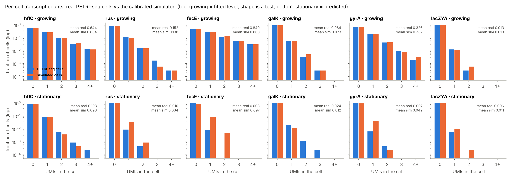
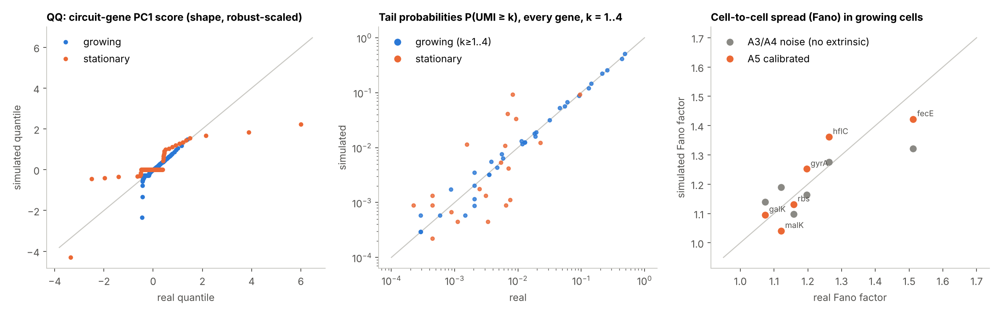
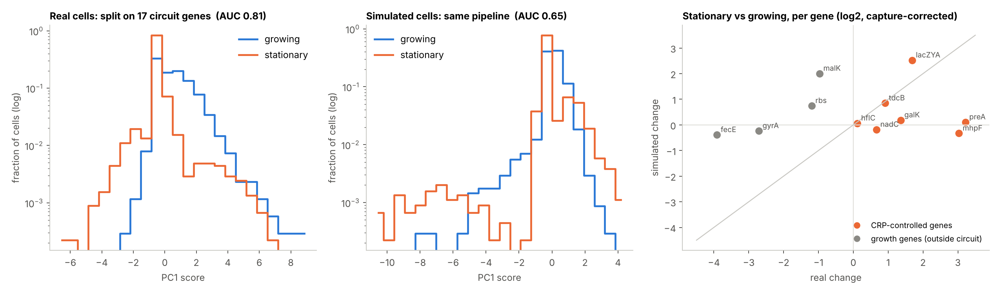
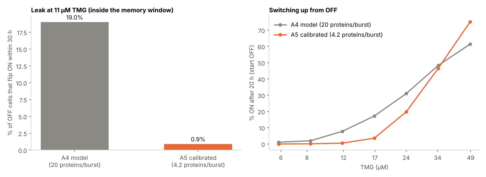

# A5 — Single-cell noise calibration (PETRI-seq)

[Main README](../../../README.md) · [Commands for every task](../../README.md) · [A1](../a1) · [A2](../a2) · [A3](../a3) · [A4](../a4) · [A5](../a5) · [A6](../a6)

> **Paper reproduced:** Blattman et al. 2020, *Nat Microbiol* 5:1192 (PETRI-seq; growing vs stationary subpopulations)  
> **Verdict:** **Adequate** — distributions match and the A4 leak is fixed; the phase split is weaker than real  
> **In one line:** Cell-to-cell noise measured in 7,929 real *E. coli* cells is added to the model; simulated cells then match real count distributions and false *lac* switching drops from 19% to 0.9%.

## Contents
1. [Question](#1-question)
2. [Inputs](#2-inputs)
3. [Method](#3-method)
4. [How to run](#4-how-to-run)
5. [Code](#5-code)
6. [Results, figure by figure](#6-results-figure-by-figure)
7. [Checks against the paper](#7-checks-against-the-paper)
8. [Decisions and deviations from the brief](#8-decisions-and-deviations-from-the-brief)
9. [Limitations](#9-limitations)
10. [Every file in this folder](#10-every-file-in-this-folder)
11. [References](#11-references)

## 1. Question
Real cells vary more than pure random chemistry predicts (*extrinsic* noise). Can we measure that extra noise from single-cell RNA-seq and add it to the model, so that simulated cells look like real ones? And do the circuit's genes alone split growing from stationary cells the way the real data does (Blattman et al. 2020)?

The calibrated model written here is the one A6 and Student B use.

## 2. Inputs
| Input | What it is | Where it comes from |
|---|---|---|
| `data/scrnaseq/GSE141018/GSM4489500_*.txt.gz` | PETRI-seq count matrix, library 2.01: *E. coli* MG1655 in EZ Rich, growing vs stationary | NCBI GEO GSE141018 (in git, 3.9 MB) |
| `petri_2_01_summary.json` | per-cell counts for the 17 circuit operons after the paper's filters | built by `src/load_scrnaseq.py` |
| `../a3/circuit_model.yaml` | the circuit | A3 |
| Yu et al. 2006 | *lac* protein burst size 4.2 ± 0.5 per mRNA | published value |

## 3. Method
1. **Load and filter** the PETRI-seq matrix as in the paper (`src/load_scrnaseq.py`): 7,929 cells (paper 8,171); median UMIs 215 growing / 29 stationary (paper 227 / 27); PC1 on all genes separates the phases perfectly (paper 99.97%).
2. **Observation model.** Sequencing captures ~5% of molecules: each cell has its own capture κ (from its total UMIs), counts are Poisson(q·κ·m). This technical noise is kept separate from biology.
3. **Fit the noise** (`src/fit_noise_params.py`). Over all genes, Fano − 1 = A + B·mean: the slope B gives extrinsic noise η², the intercept A bounds transcriptional bursting; gene–gene correlations bound shared CRP noise. Weighted method of moments, checked by approximate Bayesian computation (ABC) on a grid of 102 parameter pairs and 26 summary statistics.
4. **Expression scale.** Per-gene scale factors fitted on growing cells only (PRECISE-1K levels differ from EZ Rich), then applied to both phases, so every stationary difference comes from the circuit.
5. **The *lac* burst size** cannot be measured here (*lac* is OFF in PETRI-seq) and is set from Yu et al. 2006 (4.2 instead of 20).
6. **Validate** (`src/a5_validate.py`): simulate growing and stationary cells through the observation model, compare histograms, tails and Fano factors, and repeat the paper's PCA split on the 17 circuit operons.
7. **Robustness** (`src/a5_sensitivity.py`): which genes set η², and capture rate from 0.025 to 0.10.

## 4. How to run
From `student_a_intracellular/`, after `pip install -r requirements.txt` and `python get_data.py`:

```bash
python src/fit_noise_params.py
python src/a5_validate.py
python src/a5_figures.py
python src/a5_sensitivity.py
jupyter nbconvert --to notebook --execute --inplace notebooks/04_noise_calibration.ipynb
# or: python run_all.py a5
# optional: rebuild the PETRI-seq summary from the raw GEO file
python src/load_scrnaseq.py data/scrnaseq/GSE141018/GSM4489500_*.txt.gz
```
Takes about 5 minutes.

## 5. Code
| File | What it does |
|---|---|
| [`src/load_scrnaseq.py`](../../src/load_scrnaseq.py) | PETRI-seq count matrix → cell × operon table, with the paper's filters |
| [`src/fit_noise_params.py`](../../src/fit_noise_params.py) | fits the noise layers; writes `calibrated_circuit_model.yaml` |
| [`src/a5_validate.py`](../../src/a5_validate.py) | simulated vs real cells: distributions, tails, Fano, phase split, *lac* memory |
| [`src/a5_figures.py`](../../src/a5_figures.py) | figures; fills the medium scale factors into the model |
| [`src/a5_sensitivity.py`](../../src/a5_sensitivity.py) | robustness checks |
| [`notebooks/04_noise_calibration.ipynb`](../../notebooks/04_noise_calibration.ipynb) | the calibration, executed |
| [`tests/test_noise_calibration.py`](../../tests/test_noise_calibration.py) | noise layer, observation model, raw-file loader reproduces the summary |

## 6. Results, figure by figure
### 01_count_distributions_real_vs_sim.png: do simulated cells look real?



- **What it shows.** Per-cell transcript counts for six circuit genes: real cells (blue) vs simulated (orange).
- **Top row, growing cells.** Average levels were matched, so the *shape* is the test. Shapes match: χ²/dof 1.5, against 1.8 without the fitted noise.
- **Bottom row, stationary cells.** Pure predictions.
  - CRP genes (hflC, galK, lacZYA) match.
  - Growth genes (fecE, gyrA, rbs) are over-predicted, because real cells shut them down for reasons outside the circuit.

### 02_qq_tails_fano.png: quantile and tail checks



- **Middle.** For every gene, the probability of seeing ≥ k transcripts, real vs simulated. The points sit on the diagonal for growing cells.
- **Right.** Cell-to-cell spread (Fano factor). Adding the fitted noise moves it onto the real values: error 0.067, against 0.095 without.

### 03_growing_vs_stationary_split.png: the subpopulation split (the brief's main test)



- **Left (real cells).** Using only the 17 circuit operons, growing and stationary cells separate with AUC 0.81–0.82.
- **Middle (simulated cells, same analysis).** They separate too, but more weakly: AUC 0.65.
- **Right (each gene's change, real vs simulated).**
  - Most CRP genes (orange) move the right way.
  - Growth genes (grey) do not, because they are not in the circuit.
- **Outcome.** A similar-shaped split is reproduced, but weaker. About half of the real split is growth biology.

### 04_lac_leak_fixed.png: consequence for the switch



- **Left.** With the measured burst size (4.2 proteins per mRNA instead of 20), OFF cells at 11 µM TMG stay OFF: **0.9% leak instead of 19%**.
- **Right.** Switching from OFF becomes steeper; half of cells are ON at ~36 µM.

---

**Robustness** ([`sensitivity.json`](sensitivity.json)):
- **Which genes set η².** Fitting only the simulated genes gives the same η² (0.105). Leaving out fecE drops it to about 0, so η² rests mainly on that one gene. Treat 0.10 as an upper estimate.
- **Capture rate.** Varying q from 0.025 to 0.10 changes no conclusion.


## 7. Checks against the paper
| Check | Paper / expected | This work | Pass |
|---|---|---|---|
| Cells after filters | 8,171 | 7,929 | – |
| Median UMIs, growing / stationary | 227 / 27 | 215 / 29 | – |
| Real split on 17 circuit operons (PC1 AUC) | – | 0.81 | ✔ |
| Simulated split, calibrated | similar shape | 0.65 (weaker) | – |
| Histogram fit, growing cells (χ²/dof) | – | 1.5 (1.8 without fitted noise) | – |
| Mean levels, growing cells | match | r = 0.9955 | ✔ |
| False *lac* switching at 11 µM, 30 h | none (Vilar) | 19% → 0.9% | ✔ |

The numbers marked ✔ in `verify.py` are re-checked automatically every time it runs.

## 8. Decisions and deviations from the brief
- **Data set.** The brief names PETRI-seq; library 2.01 (growing vs stationary) is the one with the brief's subpopulation split.
- **The *lac* burst size comes from the literature**, because PETRI-seq has no *lac* signal (0.013 UMIs per cell).
- **η² is reported as an upper estimate**: leaving out one gene (*fecE*) drops it to about 0.

## 9. Limitations
- PETRI-seq measures mRNA only, at ~5% capture, with no inducer: it calibrates the CRP output genes, not *lac* switching.
- About half of the real growing/stationary split comes from growth genes falling (e.g. *fecE*, *gyrA*, *rbs*), biology outside the circuit, so the simulated split is weaker.
- The model's switching threshold (117 LacY at 11 µM) is lower than Choi et al. 2008 (~375).

## 10. Every file in this folder
| File | Contents |
|---|---|
| [`calibrated_circuit_model.yaml`](calibrated_circuit_model.yaml) | **the calibrated model**: A3's circuit with the fitted noise layers and observation model. **Used by A6 and Student B.** |
| [`noise_fit.json`](noise_fit.json) | fitted noise parameters with uncertainties and the ABC grid result |
| [`validation.json`](validation.json) | every validation number: real vs simulated, calibrated vs uncalibrated, *lac* memory |
| [`per_gene_comparison.csv`](per_gene_comparison.csv) | per gene and phase: real vs simulated mean, variance, Fano, zero fraction |
| `pc1_scores.npz` | PC1 scores of real and simulated cells (for the split figure) |
| [`sensitivity.json`](sensitivity.json) | robustness checks |
| [`raw_data_check.json`](raw_data_check.json) | the PETRI-seq summary recomputed from the raw GEO file matches |
| [`calibration_report.md`](calibration_report.md) | full write-up |
| `fig_*.png` | figures written by the code (curated versions in `figures/`) |

## 11. References
- Blattman SB et al. (2020) Prokaryotic single-cell RNA sequencing by in situ combinatorial indexing. *Nat Microbiol* 5:1192–1201. doi:10.1038/s41564-020-0729-6
- Elowitz MB et al. (2002) Stochastic gene expression in a single cell. *Science* 297:1183–1186. doi:10.1126/science.1070919
- Swain PS et al. (2002) Intrinsic and extrinsic contributions to stochasticity in gene expression. *PNAS* 99:12795–12800. doi:10.1073/pnas.162041399
- Yu J et al. (2006) Probing gene expression in live cells, one protein molecule at a time. *Science* 311:1600–1603. doi:10.1126/science.1119623
- Beaumont MA et al. (2002) Approximate Bayesian computation in population genetics. *Genetics* 162:2025–2035. doi:10.1093/genetics/162.4.2025

---
[Main README](../../../README.md) · [Commands for every task](../../README.md) · [A1](../a1) · [A2](../a2) · [A3](../a3) · [A4](../a4) · [A5](../a5) · [A6](../a6)
