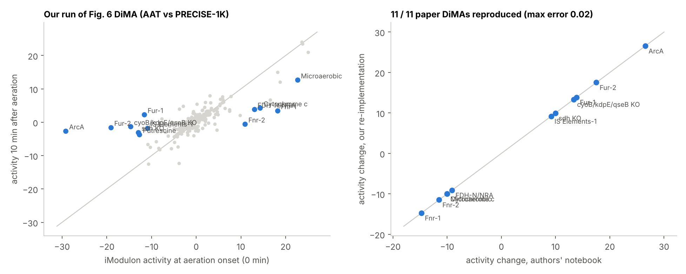
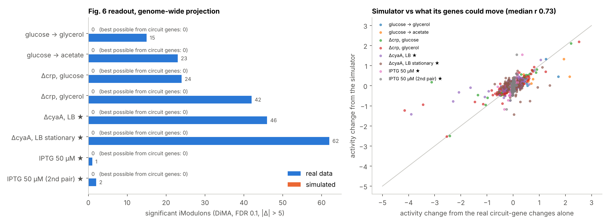
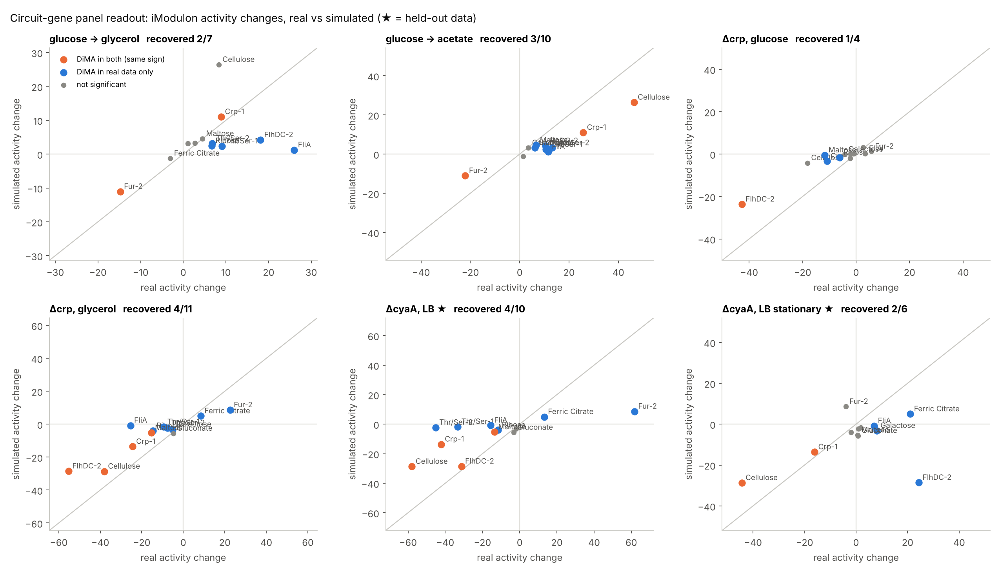
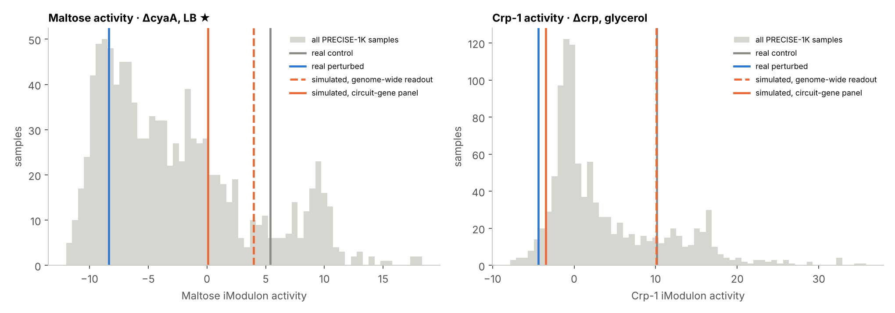

# A6 — Perturbation interface (Module 2) and DiMA validation

[Main README](../../../README.md) · [Commands for every task](../../README.md) · [A1](../a1) · [A2](../a2) · [A3](../a3) · [A4](../a4) · [A5](../a5) · [A6](../a6)

> **Paper reproduced:** Lamoureux et al. 2023, *Nucleic Acids Res* 51:10176, **Fig. 6** (comparing new data with the PRECISE-1K knowledge base by differential iModulon activity, DiMA)  
> **Verdict:** **Adequate** — paper workflow reproduced exactly; 73% of simulated calls correct; effects ~3.6× too small  
> **In one line:** Simulated knockouts and condition changes are scored exactly like the paper scored new data; 16 of the simulator's 22 iModulon calls match the real experiments.

## Contents
1. [Question](#1-question)
2. [Inputs](#2-inputs)
3. [Method](#3-method)
4. [How to run](#4-how-to-run)
5. [Code](#5-code)
6. [Results, figure by figure](#6-results-figure-by-figure)
7. [Checks against the paper](#7-checks-against-the-paper)
8. [Decisions and deviations from the brief](#8-decisions-and-deviations-from-the-brief)
9. [Limitations](#9-limitations)
10. [Every file in this folder](#10-every-file-in-this-folder)
11. [References](#11-references)

## 1. Question
When the simulated circuit is perturbed (a gene knocked out, an inducer added, the carbon source changed), does the cell change the way the real experiment does? The judge is the PRECISE-1K knowledge base, used exactly as Lamoureux et al. 2023 (Fig. 6) used it for their anaerobic → aerobic transition (AAT) data: each simulated perturbation is compared with its matched real condition by **differential iModulon activity (DiMA)**.

The perturbation classes are **Module 2**, which Student B's screen runner imports.

## 2. Inputs
| Input | What it is | Where it comes from |
|---|---|---|
| `../a5/calibrated_circuit_model.yaml` | the calibrated circuit | A5 |
| `config/precise1k_condition_map.yaml` | 11 perturbations, 8 matched to a real PRECISE-1K / K-12 condition pair | written for this task |
| PRECISE-1K + K-12 modulome | real control and perturbed samples; M for projection; replicate pairs for the DiMA null | SBRG/precise1k (`get_data.py`) |
| AAT project (K-12 modulome) | the paper's own Fig. 6 data, to reproduce first | SBRG/precise1k |

## 3. Method
1. **Reproduce Fig. 6 first** (`src/a6_reproduce_aat.py`): AAT samples → log-TPM centred on the PRECISE-1K reference samples → projected with the pseudoinverse of M → DiMA against a log-normal null fitted to replicate differences, FDR 0.05 and |Δactivity| > 9. pymodulon does not run on current pandas, so the maths is re-implemented in `src/dima.py`.
2. **The interface** (`src/perturbation.py`): `Perturbation.apply(model) → modified model` (the input is never changed). `GeneKnockout` (crp/cyaA remove CRP-cAMP; lacI → ρ = 1; lacY → no permease; a CRP-output gene → 0), `InducerLevelChange` (TMG through LacY; IPTG by passive diffusion), `CarbonSourceShift` (carbon source → glucose seen by the circuit; PTS sugars refused).
3. **Simulate** each perturbation and its in-silico control: 3 replicate populations × 2,000 cells. Mean mRNA per cell → TPM, written into the real control's expression profile (deleted genes set to 0) → projected like the AAT data.
4. **Two readouts.** *Genome-wide* (the paper's exactly). *Circuit-gene panel*: each iModulon read from its circuit genes only, keeping the 12 iModulons where this reading correlates ≥ 0.5 with the full activity over all 1,035 samples; null recomputed for this readout.
5. **Held-out test** (`src/a6_heldout.py`): refit the CRP output curves without the 32 compared samples and rerun the 4 PRECISE-1K comparisons.

## 4. How to run
From `student_a_intracellular/`, after `pip install -r requirements.txt` and `python get_data.py`:

```bash
python src/a6_reproduce_aat.py
python src/a6_dima_compare.py
python src/a6_heldout.py
python src/a6_figures.py
jupyter nbconvert --to notebook --execute --inplace notebooks/05_dima_workflow.ipynb
# or: python run_all.py a6
```
Takes about 3 minutes.

## 5. Code
| File | What it does |
|---|---|
| [`src/perturbation.py`](../../src/perturbation.py) | **Module 2**: `Perturbation` and subclasses, `apply`, `load_perturbations` |
| [`src/dima.py`](../../src/dima.py) | PRECISE-1K knowledge base: centring, projection, replicate-pair null, DiMA, panel readout |
| [`src/a6_reproduce_aat.py`](../../src/a6_reproduce_aat.py) | reproduces Lamoureux Fig. 6 |
| [`src/a6_dima_compare.py`](../../src/a6_dima_compare.py) | simulates every perturbation and compares it with the real condition |
| [`src/a6_heldout.py`](../../src/a6_heldout.py) | held-out refit and rerun |
| [`src/a6_figures.py`](../../src/a6_figures.py) | figures |
| [`config/precise1k_condition_map.yaml`](../../config/precise1k_condition_map.yaml) | perturbation → matched real condition |
| [`notebooks/05_dima_workflow.ipynb`](../../notebooks/05_dima_workflow.ipynb) | the workflow, executed |
| [`tests/test_perturbation_interface.py`](../../tests/test_perturbation_interface.py) | API contract, round-trip, knockouts, Fig. 6 reproduction |
| [`shared/schemas/perturbation_schema.md`](../../../shared/schemas/perturbation_schema.md) | the interface contract for Student B |

## 6. Results, figure by figure
### 01_paper_fig6_reproduced.png: the paper's own case first



- **What it shows.** Our rerun of the paper's anaerobic → aerobic DiMA.
  - **Left.** Activity at 0 vs 10 min, with significant iModulons labelled.
  - **Right.** Our activity changes vs the authors'.
- **Outcome.** **11 of 11** published changes recovered, each within 0.02. The workflow is reproduced exactly.

### 02_genomewide_readout.png: exactly as in Fig. 6



- **Left.**
  - **Real experiments:** change 15–62 iModulons each (blue).
  - **Simulator:** changes none.
  - **Best possible model of the circuit genes:** also none. This "ceiling" puts the real changes of our 27 genes in and holds everything else fixed.
- **Right.** The simulator's changes vs that ceiling: median r = 0.73.
- **Outcome.** The circuit is 27 of 4,257 genes, too few to move genome-wide iModulons. That is a coverage limit, not a model error.

### 03_circuit_gene_readout.png: the same data, read through the circuit's own genes



- **What it shows.** iModulon changes, real (x) vs simulated (y), for the six CRP and carbon perturbations.
- **How to read it.**
  - **Orange:** significant in both, with the same sign.
  - **Blue:** significant in the real data only.
  - **Star in the panel title:** held-out data.
- **Outcome.** The main CRP-driven changes (FlhDC-2, Crp-1, Maltose) are recovered, including on held-out ΔcyaA (4 of 10, all signs right).

| Variant | Correct calls (precision) | Real changes found (recall) |
|---|---|---|
| Default thresholds | 16 / 22 (73%) | 16 / 48 (33%) |
| Paper's stricter thresholds | 8 / 9 (89%) | 8 / 37 (22%) |
| Multi-gene iModulons only | 10 / 12 (83%) | 10 / 25 (40%) |
| CRP curves refitted without the compared samples | 9 / 11 (82%) | 9 / 32 (28%) |

Precision stays 73–89% in every variant. Stricter thresholds lower recall, not precision. The agreement does not come from fitting the comparison data.

### 04_gene_level_and_IPTG.png: individual genes
- **Left.** Each circuit gene's change, real vs simulated. The direction is right for 91–100% of genes that really change more than 2-fold (57% in stationary LB), but the size is about 3.6× too small (slope 0.28).
- **Right.** lac induction by 50 µM IPTG. The model turns lac fully ON (~100×). The real strains rise much less (lacZ 2.9–4.8×), so the model is 38–64× too strong.
- **Why.** The real strains carry extra-LacI (lacIq) plasmids, and the model has no LacI-dose parameter. This is the clearest miss and the first fix for the future.

### 05_activity_histograms.png: Fig. 6-style activity histograms



- **What it shows.** Grey is all PRECISE-1K samples, with lines for the real control, the real perturbed sample and the simulation.
- **Outcome.**
  - **Circuit-gene reading:** the simulation lands near the real perturbed sample.
  - **Genome-wide reading:** it barely moves (same message as figure 02).


## 7. Checks against the paper
| Check | Paper / expected | This work | Pass |
|---|---|---|---|
| Paper's AAT DiMAs found | 11 | 11 of 11 | ✔ |
| Largest activity error vs the paper | – | 0.016 | ✔ |
| Panel calls correct (precision) | – | 16 of 22 (73%) | ✔ |
| Real panel changes found (recall) | – | 16 of 48 (33%) | ✔ |
| At the paper's stricter thresholds | – | 8 of 9 | ✔ |
| Multi-gene iModulons only | – | 10 of 12 | ✔ |
| Held-out refit, 4 PRECISE-1K pairs | – | 9 of 11 (vs 10 of 12 in-sample) | ✔ |
| Genome-wide DiMAs (paper's readout) | real: 15–62 per perturbation | 0 (also 0 at the ceiling, see figure 02) | – |

The numbers marked ✔ in `verify.py` are re-checked automatically every time it runs.

## 8. Decisions and deviations from the brief
- **A circuit-gene panel readout was added.** With the paper's genome-wide readout even the real changes of the circuit's 27 genes alone move no iModulon past the threshold (the 'ceiling'), so it cannot score a 27-gene model. The panel reads the same data through the genes the model makes. The genome-wide result is still reported.
- **3 perturbations have no real match** (TMG dose, ΔlacI, ΔlacY): none exists in PRECISE-1K or the K-12 modulome, and the condition map says so.
- **Thresholds.** The panel uses FDR 0.1 / |Δ| > 5; the paper's stricter 0.05 / 9 is also reported.

## 9. Limitations
- Simulated gene changes are about 3.6× smaller than measured (slope 0.28).
- IPTG induces *lac* 38–64× too strongly in the strains carrying extra LacI.
- Gluconate is a repeated false positive: the model drops *idnO* on CRP loss more than real cells do.
- Two panel iModulons (Cellulose, Fur-2) are read from a single gene each.

## 10. Every file in this folder
| File | Contents |
|---|---|
| [`perturbation_dima_comparison.csv`](perturbation_dima_comparison.csv) | **main result**: 8 perturbations × 201 iModulons — simulated and real activity changes, q-values, DiMA calls |
| [`perturbation_summary.csv`](perturbation_summary.csv) | one row per perturbation: real, simulated and recovered DiMAs for each readout |
| [`panel_dima_comparison.csv`](panel_dima_comparison.csv) | the circuit-gene panel readout in detail |
| [`gene_level_comparison.csv`](gene_level_comparison.csv) | simulated vs real change for each circuit gene |
| [`simulated_samples_log_tpm.csv`](simulated_samples_log_tpm.csv) | the pseudo-bulk simulated samples |
| [`aat_check.json`](aat_check.json), [`aat_dima_reproduction.csv`](aat_dima_reproduction.csv) | the Fig. 6 reproduction vs the paper |
| [`a6_results.json`](a6_results.json) | all summary numbers |
| [`heldout/`](heldout) | the held-out refit: refitted model, CRP-output fits, and the same comparison files |
| `fig_a6_*.png` | figures written by the code (curated versions in `figures/`) |
| [`a6_report.md`](a6_report.md) | full write-up |

## 11. References
- Lamoureux CR et al. (2023) *Nucleic Acids Res* 51:10176–10193. doi:10.1093/nar/gkad750
- Bui TT, Selvarajoo K (2020) Attractor concepts … anaerobic to aerobic state transition in *E. coli*. *Sci Rep* 10:5878. doi:10.1038/s41598-020-62804-3
- Sastry AV et al. (2021) Mining all publicly available expression data … (pymodulon). *bioRxiv*. doi:10.1101/2021.07.01.450581
- Benjamini Y, Hochberg Y (1995) Controlling the false discovery rate. *J R Stat Soc B* 57:289–300. doi:10.1111/j.2517-6161.1995.tb02031.x

---
[Main README](../../../README.md) · [Commands for every task](../../README.md) · [A1](../a1) · [A2](../a2) · [A3](../a3) · [A4](../a4) · [A5](../a5) · [A6](../a6)
