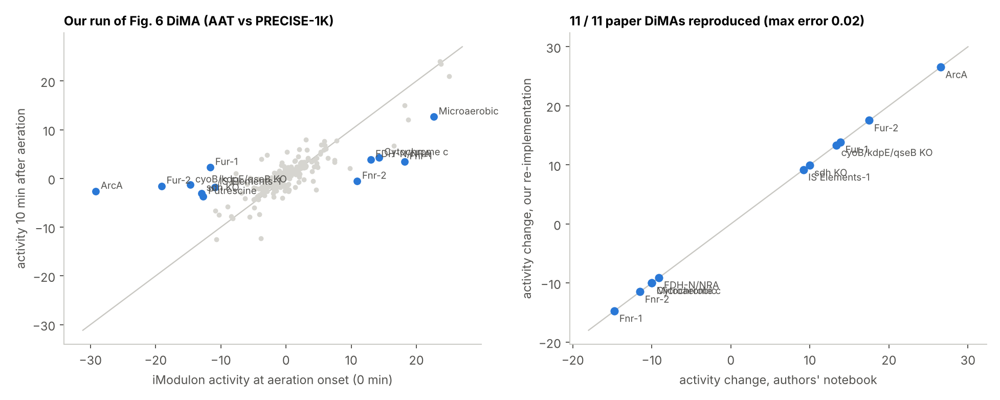
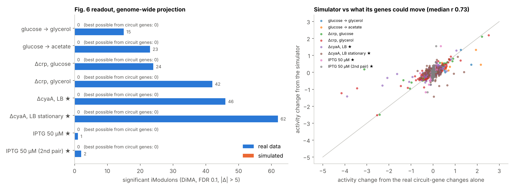
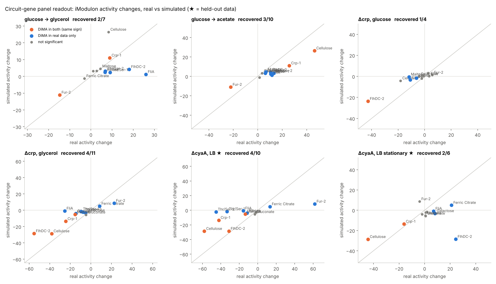
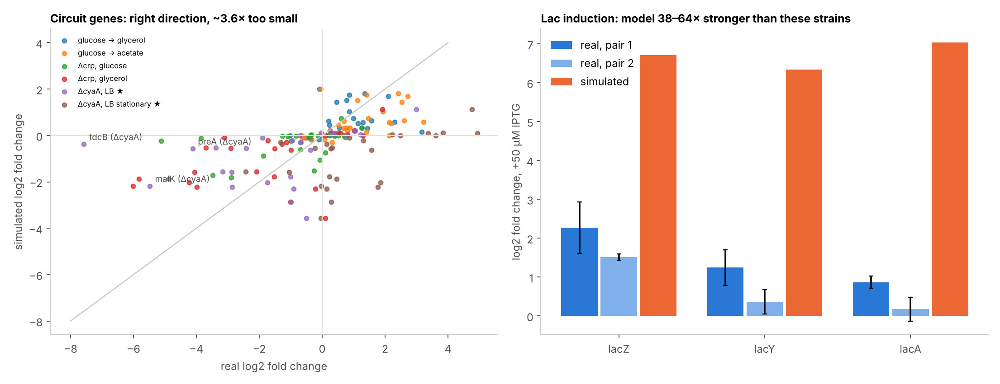
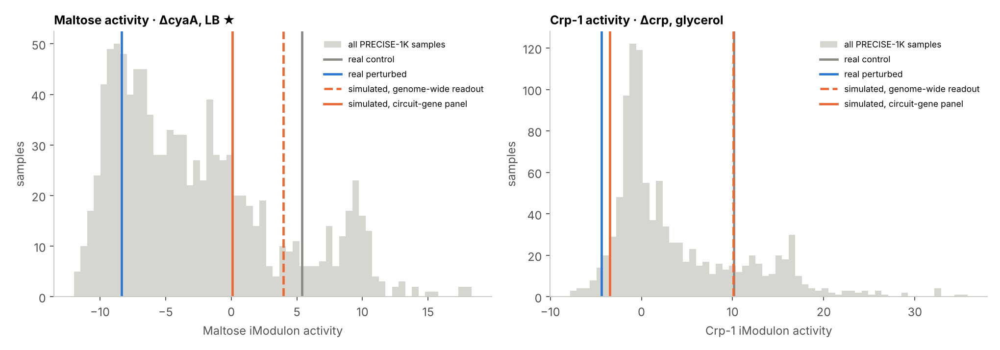

# A6 · Perturbation interface (Module 2) and the Fig. 6 DiMA workflow

**Question.** When we perturb the simulated circuit (knock out a gene, add an inducer, change the carbon source), does it change
the cell the way the real experiment does? We judge this through the PRECISE-1K knowledge base, the same way Lamoureux et al. 2023
(Fig. 6) judged their new anaerobic → aerobic transition (AAT) data.

## 1 · The paper's workflow, reproduced first



- **How the AAT data were processed.** The AAT samples from the K-12 modulome went through three steps:
  - log-TPM, centred on the PRECISE-1K reference samples;
  - projected with the pseudoinverse of **M**;
  - compared with DiMA at FDR 0.05 and |Δ| > 9. The DiMA null is a log-normal fit to differences between replicates.
- **Match to the paper.** All 11 of the paper's DiMAs are reproduced, and every activity change is within 0.02 of the authors' notebook.
  - One extra iModulon, Putrescine, sits exactly on the threshold (Δ = 9.005).
- **Why not use pymodulon directly.** pymodulon 0.2.1 fails to load on current pandas, so the same maths is re-implemented in `src/dima.py`.

## 2 · The interface Student B uses

```python
from perturbation import load_perturbations, GeneKnockout, InducerLevelChange, CarbonSourceShift
model = yaml.safe_load(open("outputs/calibrated_circuit_model.yaml"))          # A5 output
for pert in load_perturbations("config/precise1k_condition_map.yaml"):          # every defined perturbation
    modified = pert.apply(model)                # -> new model dict; the input model is never changed
    for rep in range(1, 4):
        traj = StochasticCircuit(modified).run(seed=rep)   # replicate populations
```

| Class | What it changes in the model | Example |
|---|---|---|
| `GeneKnockout` | Records the deleted genes. crp/cyaA → CRP-cAMP removed. lacI → no repression (ρ = 1). lacY → no permease. A CRP-output gene → its expression set to 0. | `GeneKnockout("cyaA")` |
| `InducerLevelChange` | TMG enters through LacY (the A3/A4 feedback loop). IPTG enters by diffusion (new passive influx, internal = external). | `InducerLevelChange(IPTG_uM=50)` |
| `CarbonSourceShift` | Carbon source → glucose seen by the circuit. Glucose 2 g/L = 11.1 mM; glycerol, acetate and LB = 0. Fructose and other PTS sugars are refused, because the circuit has no independent CRP value for them. | `CarbonSourceShift(carbon_source="glycerol")` |

- **Faster loop.** `sc.run(pert)` on one compiled engine gives identical trajectories without recompiling (this is tested).
- **Condition map.** `config/precise1k_condition_map.yaml` lists 11 perturbations. 8 have a matched real condition; 3 (TMG dose, ΔlacI, ΔlacY) have none in PRECISE-1K or the K-12 modulome, and the file says so.

## 3 · Simulated vs matched real conditions

**How each simulated sample is made.**
1. 3 replicate populations × 2,000 cells for each perturbation and its in-silico control.
2. The mean mRNA per cell becomes TPM, written into the real control condition's expression profile.
3. Deleted genes are set to 0.
4. The sample is then projected exactly like the AAT data.

The full table is `outputs/perturbation_dima_comparison.csv`: 8 perturbations × 201 iModulons, with simulated and real activities, differences, q-values and DiMA calls.

### 3a · Genome-wide readout (Fig. 6 exactly): the circuit is too small to register



- **Real experiments.** They move 15–62 iModulons each.
- **Simulator.** It moves none past the DiMA threshold.
- **Ceiling.** We also took the real changes of the circuit's own 27 genes, holding all other genes at the control. That moves none past the threshold either.
- **Why.** The circuit makes 27 of the 4,257 genes, and the projection spreads their signal over the whole genome.
- **Within that limit the simulator is right.** Its activity changes follow the ceiling (median r = 0.73 across perturbations).

### 3b · Circuit-gene panel readout: same data, read through the genes the model actually makes

- **What it is.** Each iModulon's activity is read from its circuit member genes only (least squares).
- **Which iModulons qualify.** We kept the 12 where this reading correlates ≥ 0.5 with the full activity across all 1,035 PRECISE-1K samples. Strain and evolution iModulons are excluded.
- **Null distribution.** Same method as before, recomputed for this readout.



| Perturbation | Real panel DiMAs | Recovered by the simulator (same sign) | Simulator-only | r |
|---|---|---|---|---|
| glucose → glycerol | 7 | 2 (Crp-1, Fur-2) | Cellulose | 0.39 |
| glucose → acetate | 10 | 3 (Crp-1, Fur-2, Cellulose) | – | 0.96 |
| Δcrp, glucose | 4 | 1 (FlhDC-2) | – | 0.94 |
| Δcrp, glycerol | 11 | 4 (FlhDC-2, Crp-1, Maltose, Cellulose) | Gluconate | 0.90 |
| **ΔcyaA, LB (held out)** | 10 | **4** (FlhDC-2, Crp-1, Maltose, Cellulose) | Gluconate | 0.70 |
| ΔcyaA, LB stationary (held out) | 6 | 2 (Crp-1, Cellulose) | Gluconate, Maltose; FlhDC-2 wrong sign | 0.36 |
| IPTG 50 µM, 2 pairs (held out) | 0 | 0 | 0 | – |

- **Overall.** 16 of the simulator's 22 panel DiMAs are real, with the same sign (73% precision). It finds 16 of the 48 real ones (33% recall).
- **Single-gene readouts.** Cellulose (yahN) and Fur-2 (preA) are each read from one gene, so treat them as gene-level hits.
- **Gluconate.** It is the repeated false positive: the model drops idnO on CRP loss more than the real cells do.
- **Stationary phase.** The circuit has no growth-phase input, so this is the weakest match.

### 3c · Gene level: right direction, too small, and lac over-induced



- **Direction.** Across the CRP/carbon perturbations, 91–100% of genes that really move more than 2-fold move the same way in the simulator. The exception is stationary LB at 57%.
- **Size.** The changes are about 3.6× too small (slope 0.28).
  - The largest misses are tdcB, malK/lamB and preA after cyaA loss in LB. Their LB levels far exceed anything in the M9 data the CRP-output curves were fitted on.
- **IPTG (held out).** The model switches every cell fully ON: lacZYA up ~100-fold, log2 6.7.
  - The real strains rise only 1.5–2.3 log2 for lacZ, which is 38–64× less.
  - These strains carry lacIq plasmids (extra LacI) and the medium contains glucose. The model has neither extra LacI nor a reason to resist 50 µM IPTG.
  - This is the clearest miss and a concrete fix for A3: add LacI dosage as a parameter.



- **What this shows.** These are the Fig. 6 activity histograms (all PRECISE-1K samples, with the matched samples overlaid).
- **Panel vs genome-wide.** The panel-read simulation lands near the real perturbed sample. The genome-wide reading barely moves from the control, which is section 3a's point.

## 4 · What to say on the slide

1. **Reproduction.** The paper's Fig. 6 workflow is reproduced exactly (11/11 DiMAs).
2. **Genome-wide.** A 27-gene circuit cannot produce genome-wide iModulon changes. This is a coverage limit, not a dynamics error; the simulator tracks what its genes can do (r ≈ 0.7).
3. **Panel.** Read through its own genes, the simulator recovers the main CRP-dependent iModulon shifts after crp/cyaA loss, including in held-out data:
   - FlhDC-2, Crp-1, Maltose;
   - 100% sign agreement on held-out ΔcyaA.
   - The changes are too small, and lac induction by IPTG is far too strong for lacIq strains.
4. **Not testable here.** TMG doses, ΔlacI and ΔlacY have no matched data in PRECISE-1K or the K-12 modulome. They stay validated against Ozbudak 2004 / Kuhlman 2007 only.

## Files

| File | What it is |
|---|---|
| `src/perturbation.py` | Module 2: Perturbation, GeneKnockout, InducerLevelChange, CarbonSourceShift, `apply()`, `load_perturbations()` |
| `config/precise1k_condition_map.yaml` | Each perturbation → matched PRECISE-1K / K-12 condition (held-out flag, notes, unmatched reasons) |
| `notebooks/05_dima_workflow.ipynb` | Executed: AAT reproduction → perturbations → comparison |
| `outputs/perturbation_dima_comparison.csv` | Per perturbation × iModulon: simulated vs real activity, difference, q, DiMA calls, ceiling |
| `outputs/a6/panel_dima_comparison.csv`, `gene_level_comparison.csv`, `perturbation_summary.csv` | Panel and gene-level results |
| `outputs/a6/aat_dima_reproduction.csv`, `aat_check.json` | Fig. 6 reproduction |
| `src/dima.py`, `src/a6_reproduce_aat.py`, `src/a6_dima_compare.py`, `src/a6_figures.py` | Code |
| `tests/test_perturbation_interface.py` | 8 tests (34 in the whole suite, all passing) |
| `shared/schemas/perturbation_interface.md` | Contract for Student B (B3 screen_runner) |

**Engine changes (Module 1, backward compatible; all A4/A5 tests still pass):**
- `StochasticCircuit` accepts the dict from `apply()`;
- `run()` with no argument runs the embedded perturbation;
- `run(seed=...)` runs replicates;
- an IPTG passive-influx term `k_pass` (0 by default);
- the default seed is now 1, because GillesPy2 rejects 0.

**Data needed to rerun** (not in the zip; from your `gbm_miner_ecoli/precise1k/data/`), placed in `data/precise1k/` as:
`p1k_precise1k.json.gz`, `p1k_log_tpm_qc.csv`, `p1k_metadata_qc.csv`, `p1k_counts.csv` (from `precise1k/`) and
`k12_counts.csv`, `k12_metadata_qc.csv` (from `k12_modulome/`).

## Robustness checks (added 24 Nov 2026, `src/a6_heldout.py`, `outputs/a6/heldout/`)

| Variant | Real changes | Simulated calls | Correct | Precision | Recall |
|---|---|---|---|---|---|
| Six CRP / carbon perturbations, FDR 0.1, abs(Δa) > 5 | 48 | 22 | 16 | 73% | 33% |
| Same, paper's Fig. 6 thresholds (FDR 0.05, abs(Δa) > 9) | 37 | 9 | 8 | 89% | 22% |
| Same, multi-gene iModulons only | 25 | 12 | 10 | 83% | 40% |
| Four PRECISE-1K pairs, CRP curves in-sample | 32 | 12 | 10 | 83% | 31% |
| Four PRECISE-1K pairs, CRP curves refitted without the 32 compared samples | 32 | 11 | 9 | 82% | 28% |

- **Precision holds.** 73–89% of simulated calls are real changes with the right sign in every variant. Stricter thresholds lower recall, not precision.
- **Held-out refit.** With the CRP curves refitted on the remaining 977 PRECISE-1K samples, gene-level sign agreement stays 75–94%.
- **Conclusion.** The agreement does not come from fitting the comparison data.
