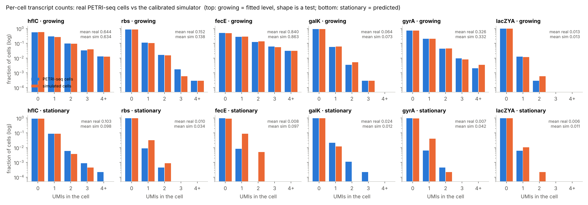
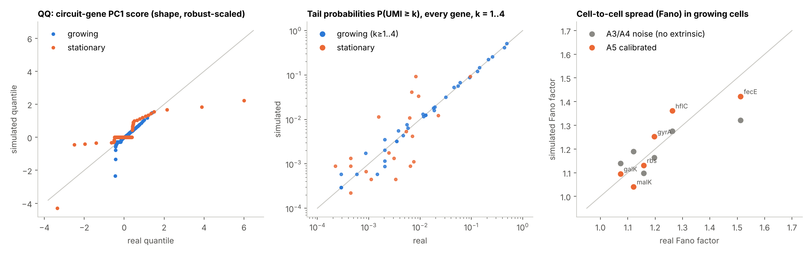
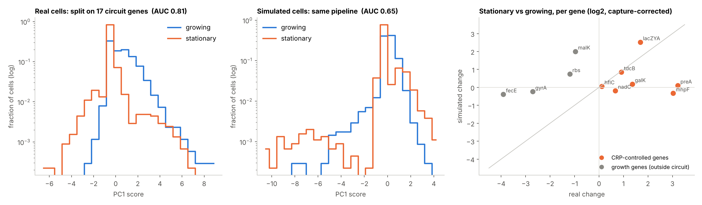
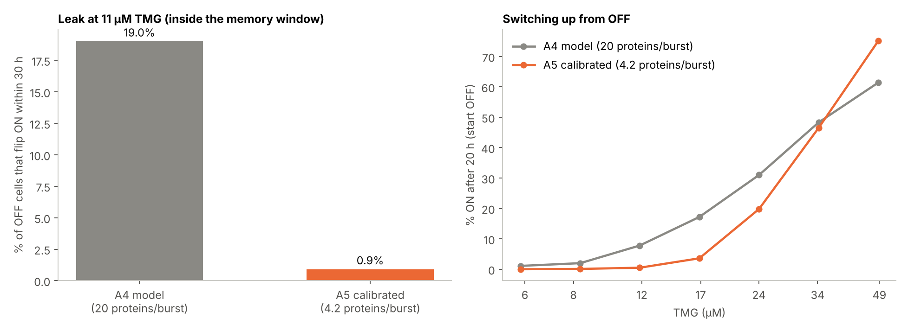

# A5 · Single-cell noise calibration (PETRI-seq)

**Question.** If we give the circuit model realistic cell-to-cell noise, do simulated cells look like real single bacteria?
And do the circuit's genes alone split growing from stationary cells the way the real data does?

**Data.** Blattman et al. 2020 PETRI-seq, GEO **GSE141018**, library 2.01 (*E. coli* MG1655, EZ Rich, growing vs stationary).
After the paper's filters: **7,929 cells** (3,430 growing, 4,499 stationary). The paper reports 8,171.
Median mRNA UMIs per cell are 215 (growing) and 29 (stationary); the paper reports 227 and 27.
On all genes, PC1 separates the two phases perfectly (AUC 1.00; the paper reports 99.97%).
Summary file: `data/scrnaseq/GSE141018/petri_2_01_summary.json`.

## Answer in one picture

- **Top row (growing cells): the shapes match.** Gene levels were fitted on growing cells, but the cell-to-cell shape was not fitted directly.
  - Across all genes, the histogram fit is χ²/dof = 1.5.
  - The model without added noise (A3/A4) gives 1.8.
- **Bottom row (stationary cells): these are pure predictions.**
  - They match the real cells for the CRP-controlled genes (hflC, galK, lacZYA).
  - They miss for the growth genes (fecE, gyrA, rbs). Real cells shut these down in stationary phase, and the circuit has no growth program.

## The QQ / spread check

- **Middle panel.** For every gene and every count, the real and simulated tail probabilities lie on the diagonal in growing cells.
  - Stationary points scatter more, mostly from the growth genes.
- **Right panel.** Adding the fitted extrinsic noise moves the Fano factors onto the diagonal.
  - Error falls from 0.095 (A3/A4) to 0.067.

## Does the circuit reproduce the subpopulation split?

| | Real cells | Simulated, calibrated | Simulated, A3/A4 noise |
|---|---|---|---|
| Split on the 17 circuit operons (PC1 AUC) | **0.81** | **0.65** | 0.69 |

**Partly.** The simulator produces a stationary subpopulation from the circuit genes, but it is weaker than the real one.

- **What the simulator gets right.** The right panel shows the CRP-controlled genes:
  - Most move in the right direction when glucose runs out (CRP activity 0.2 → 1): lacZYA, tdcB, galK, hflC.
  - preA and mhpF rise more in the real cells than in the model.
- **What it misses.** Half of the real split comes from growth genes falling (fecE, gyrA, rbs, malK).
  - That biology lies outside a CRP/lac circuit, so the model cannot reproduce it.
- **Why calibration lowers the AUC (0.69 → 0.65).** Calibration adds realistic noise. That blurs the simulated split slightly, which is the honest result.

## Fitted noise parameters (layered onto A3 in `calibrated_circuit_model.yaml`)

| Parameter | Value | How it was fitted | What it means |
|---|---|---|---|
| `output_extrinsic_cv2` (η²) | **0.10 ± 0.04** | Method of moments: Fano − 1 = A + B·mean over all genes | Cells differ ~30% in each gene's transcription rate |
| `output_burst_b` | 0 (upper bound 0.54) | Intercept of the same fit | No transcription bursting detectable at ~5% capture |
| `crp_extrinsic_sigma` | 0 (upper bound 1.8) | Gene–gene correlations (all \|r\| < 0.09) | Shared CRP noise is not constrained by this data |
| `lac_protein_burst` | **4.2** proteins/burst (was 20) | Yu et al. 2006 (single-molecule LacZ–YFP fusion) | The lac operon is OFF here (~1% of cells), so PETRI-seq cannot measure it |
| Capture (observation model) | q0 = 0.05; κ CV² 0.33 / 0.21 | Real per-cell UMI totals | Technical noise, kept separate from biology |

**ABC cross-check.** We ran a grid of 102 (η², b) pairs and compared 26 summary statistics.
- ABC accepts η² from 0 to 0.125, which contains the moment estimate.
- Its single best point (η² = 0, b = 0.5) trades extrinsic noise for bursting. At ~1 UMI per cell, the two look almost the same.
- We keep the moment estimate, which uses the mean–variance trend across all genes, and report the ABC range as the uncertainty.

**Expression scale.** The PRECISE-1K levels do not match EZ Rich.
- Per-gene scale factors are fitted on growing cells only. They range from 0.3× (flhD) to 240× (fecE).
- They are stored in `observation_model.petri_ez_rich_medium`.
- They are applied in both phases, so every stationary-phase difference comes from the circuit.

## Consequence for the lac switch (fixes the A4 leak)

- **Leak.** With realistic burst size (4.2 proteins per burst instead of 20), uninduced cells at 11 µM TMG stay OFF.
  - A4 had 19% of cells leaking ON within 30 h; the calibrated model has 0.9%.
  - Basal LacY Fano falls from 39 to 5.
- **Switching.** The up-switch curve becomes steeper, with half of cells switched at ~35 µM.
- **Remaining gap.** The model's switching threshold is lower than Choi et al. 2008 (~375 LacY): 117 LacY at 11 µM, 400 at 5 µM.

## Limits to state on the slide

1. **No lac data.** PETRI-seq measures mRNA only, at ~5% capture, with no inducer. It calibrates noise for the CRP output genes, not lac switching. Lac noise comes from Yu 2006.
2. **Growth biology missing.** Half of the real split is growth physiology that the circuit does not contain.
3. **Shared CRP noise unpinned.** It needs a dataset with more UMIs per cell, or a dual-reporter experiment.

## Files

- **Code.** `src/load_scrnaseq.py` (reads the GEO file), `src/fit_noise_params.py` (method of moments + ABC), `src/a5_validate.py` (simulate + compare), `src/a5_figures.py`.
- **Notebook.** `notebooks/04_noise_calibration.ipynb` (executed).
- **Outputs.** `outputs/calibrated_circuit_model.yaml`, plus `outputs/a5/` (`noise_fit.json`, `validation.json`, `per_gene_comparison.csv`, `pc1_scores.npz`, figures).
- **Tests.** `tests/test_noise_calibration.py` (3 new; 26 in total, all passing).
- **Downstream (A6, Student B Module 4).** Load with `StochasticCircuit("outputs/calibrated_circuit_model.yaml")`. The noise layer is applied automatically, and trajectory metadata records `noise` and `crp_outputs_method`.

## Robustness checks (added 24 Nov 2026, `src/a5_sensitivity.py`, `outputs/a5/sensitivity.json`)

- **Raw data rerun.** All PETRI-seq numbers were recomputed from the raw GEO file (`data/scrnaseq/GSE141018/GSM4489500_…gene_matrix.txt.gz`) with `src/load_scrnaseq.py`.
  - Cell counts (3,430 growing / 4,499 stationary) and every per-gene count histogram are identical to the earlier in-browser extraction.
  - Gene means agree within 0.3%.
  - The 17-operon split comes out at AUC 0.82 (0.81 before).
  - Recorded in `outputs/a5/raw_data_check.json`; a test checks it.
- **Which genes set η².** Fitting only the 12 simulated operons gives the same value, 0.105 ± 0.049.
  - Leaving one gene out at a time shows the estimate rests mainly on **fecE**, the most expressed circuit gene. Without it η² ≈ 0, which is where the ABC check put its best point.
  - Read η² = 0.10 as an upper estimate supported mostly by one gene. The other genes are near-Poisson at this depth.
- **Capture rate q.** q does not change η², but it does change the burst bound and the fit:
  - at q = 0.025 and 0.10 the growing-cell histograms fit somewhat worse (χ²/dof 1.9 and 2.3, against 1.5 at q = 0.05);
  - the simulated split stays at AUC 0.64–0.71.
